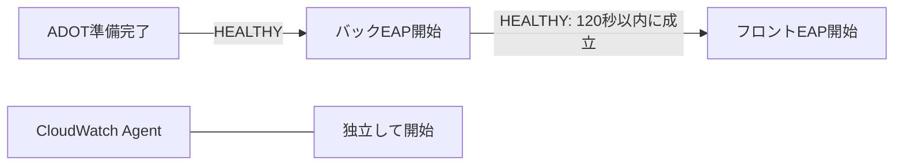

# ECS Fargate ヘルスチェック・起動依存関係 設計ガイド

UBI / OpenJDK 21 / JBoss EAP 8.1 · フロント / バック / ADOT / CloudWatch Agent

確認日：2026-10-07。Excel版と共通の原稿から生成。実起動時間は仮定です。

## 目次

- [00_結論と読み方 最初に押さえる結論](#00_結論と読み方)

- [01_仕組みと時計 お店の開店にたとえて理解する](#01_仕組みと時計)

- [01b_用語をやさしく 途中で困らないための用語集](#01b_用語をやさしく)

- [02_設定値の範囲 どこに何を指定できるか](#02_設定値の範囲)

- [03_依存とessential dependsOnとessentialの正確な役割](#03_依存とessential)

- [04_パターン比較 時間パターン別の具体案](#04_パターン比較)

- [05_コンテナ設定 4コンテナに入れる具体値](#05_コンテナ設定)

- [06_ALBとサービス ALBの判定とECSの猶予を組み合わせる](#06_ALBとサービス)

- [07_起動時系列 時刻を並べて動きを見る](#07_起動時系列)

- [08_時間計算 値を選ぶための計算方法](#08_時間計算)

- [09_EAPと健康判定 UBI / Java / EAPで何を確かめるか](#09_EAPと健康判定)

- [10_ADOTとCWAgent サイドカーの開始・検査・欠損対策](#10_ADOTとCWAgent)

- [11_検査コマンド コンテナ内で動く検査の具体例](#11_検査コマンド)

- [12_JSON設定例 ECS JSONへ落とし込む](#12_JSON設定例)

- [13_Terraformと補助 Terraformとコンテナ内の補助実装](#13_Terraformと補助)

- [14_障害と運用 稼働中・停止中も同じ構成を点検する](#14_障害と運用)

- [15_測定と検証 実環境へ当てはめる手順](#15_測定と検証)

- [16_歴史と背景 なぜ複数の仕組みができたのか](#16_歴史と背景)

- [17_よくある疑問 設定を決める前の最終確認](#17_よくある疑問)

- [18_出典と適用範囲 出典・確認範囲](#18_出典と適用範囲)


<a id="00_結論と読み方"></a>

## 00_結論と読み方｜最初に押さえる結論

確認日：2026-10-07。AWS・Red Hat・OpenTelemetry等の一次情報を確認。数値例は測定値ではなく設計用の仮定です。

### 今回の条件

実行環境はECS Fargate（Linux）。フロントとバックはUBI上のOpenJDK 21 / JBoss EAP 8.1として説明します。タスクにはADOT Collector（essential=true）とCloudWatch Agent（essential=false）も置きます。実際の起動時間・アプリの健康判定URL・イメージのタグ・CPU/メモリ量は未提示です。以下の秒数はAWS推奨の固定値ではなく、仮定に対して計算した候補です。

### 誤解しやすい点と正しい読み替え

| 論点 | 正しい考え方 | 実務上の結論 |
| --- | --- | --- |
| startPeriod=210 | そのコンテナの起動直後に失敗を数えない猶予。検査は実行され、途中の成功でHEALTHYになれる。 | 210秒そのものを起動時間として足し算しない。 |
| ELB / ALBの猶予300秒 | 実体はECSサービスのhealthCheckGracePeriodSeconds。ALBの検査開始を遅らせない。 | ALBが異常を報告しても、ECSの健康判定に基づく置換を猶予する。 |
| HEALTHY依存 | 依存先の最初の健康判定成功を待つ。起動順序を制御する。 | 依存先の実際の準備時間＋検査・通知の遅れを測る。 |
| Fargateの待機上限 | 明示できるstartTimeoutは2–120秒。依存先側へ設定する。 | 初回HEALTHYまで210秒かかるバックを120秒の依存待ちで待つ設計は成立しない。 |
| 300秒の起点 | タスクの作成時刻、最初のコンテナ開始、task.startedAt、各コンテナStartedAtは別。 | task.startedAtを基準に残りの準備時間を評価し、実イベントでも突き合わせる。 |
| 13133番が200 | Collectorのヘルスエンドポイントが成功したこと。全トレースの永続保存を証明しない。 | 起動順に加え、SDK・Collectorの再試行、キュー、保存先での受信を確認する。 |

出典：[S01 AWS ECS HealthCheck API](https://docs.aws.amazon.com/AmazonECS/latest/APIReference/API_HealthCheck.html) [S03 AWS ECS ContainerDefinition API](https://docs.aws.amazon.com/AmazonECS/latest/APIReference/API_ContainerDefinition.html) [S04 AWS ECS ContainerDependency API](https://docs.aws.amazon.com/AmazonECS/latest/APIReference/API_ContainerDependency.html) [S05 AWS ECS UpdateService API](https://docs.aws.amazon.com/AmazonECS/latest/APIReference/API_UpdateService.html) [S06 AWS ECS Task API](https://docs.aws.amazon.com/AmazonECS/latest/APIReference/API_Task.html) [S16 ADOT 公式healthcheck実装](https://github.com/aws-observability/aws-otel-collector/blob/main/cmd/healthcheck/main.go) [S18 OpenTelemetry Collector resiliency](https://opentelemetry.io/docs/collector/resiliency/)

### 未計測の現時点での選び方

まずはP4を検証候補とします。ADOTのHEALTHYを待って両方のEAPを並列に開始し、フロントとバックの間にはHEALTHY依存を置きません。startPeriodはADOT 30秒、CloudWatch Agent 30秒、バック210秒、フロント210秒、ECSサービス猶予300秒とする例です。ALBにはフロントからバックまで最低限使えることを判定するreadinessを設定します。バックがいない間もフロントが起動し続け、再接続できる実装が前提です。

### 希望どおり直列にする場合

バックの『コンテナ開始→初回HEALTHY』が負荷の高い時も十分に120秒未満ならP1 / P2が候補です。例えばバックが95秒でHEALTHY、フロントの準備が200秒なら、フロントのstartPeriod=210とサービス猶予300を維持できる時間例を示します。バック自身が200秒以上かかるなら、サービス猶予を600へ変更するだけでは120秒の依存待ちの問題を解消できません。

出典：[S03 AWS ECS ContainerDefinition API](https://docs.aws.amazon.com/AmazonECS/latest/APIReference/API_ContainerDefinition.html) [S12 AWS Fargate タスク定義パラメータ](https://docs.aws.amazon.com/AmazonECS/latest/developerguide/task_definition_parameters.html)

### 210秒を短くする効果

210を60へ変更しても、アプリの初期化処理は速くなりません。変わるのは失敗を数え始める時刻です。準備完了を早く検知したい場合は、準備完了条件を正しく実装したうえでintervalを30秒から10秒などへ調整します。十分な余裕を持つ実測結果が出てからstartPeriodを縮めます。

出典：[S01 AWS ECS HealthCheck API](https://docs.aws.amazon.com/AmazonECS/latest/APIReference/API_HealthCheck.html)

### 読み進め方

仕組みと時計→設定範囲→依存関係→パターン比較→起動時系列の順で読めます。Excelの『08_時間計算』は白い入力セルを書き換えると見積もりが変わります。JSON・Terraformは設定の位置を示すテンプレートです。AWSへの適用や実機負荷試験は行っていません。

<a id="01_仕組みと時計"></a>

## 01_仕組みと時計｜お店の開店にたとえて理解する

『動いている』『準備ができた』『お客さんを入れてよい』を分けると、各設定の役割が見えます。

### 登場人物

| 登場するもの | 小学生向けのたとえ | 実際の仕事 |
| --- | --- | --- |
| ECSサービス | お店を決まった数だけ営業させる店長 | 必要タスク数を保ち、起動失敗や健康状態に応じてタスクを入れ替える。 |
| Fargateタスク | 同じ建物で働く1チーム | 今回の4コンテナをひとまとめに実行する。 |
| フロントエンド | 注文を受ける受付 | 利用者のHTTPリクエストを受け、必要に応じバックのAPIを呼ぶ。 |
| バックエンド | 注文どおりに調理する台所 | APIや業務処理を実行する。Javaプロセスが起動しただけでは調理可能とは限らない。 |
| ADOT Collector | 仕事の記録を受け取る係 | OTLPなどでトレースを受け取り、加工して保存先へ送る。 |
| CloudWatch Agent | 別の測定・記録係 | 構成されたメトリクスやログ等を収集・送信する。ADOTと役割を決めて重複を防ぐ。 |
| ALB | 開いているお店へお客さんを案内する係 | ターゲットへHTTP健康確認を行い、状態に基づいてリクエストを振り分ける。 |

### 混同してはいけない4つの時計

| 時計 | 起点・対象 | 時間内でも行われること | 延ばしても解決しないこと |
| --- | --- | --- | --- |
| startPeriod | 各コンテナが開始してから。そのコンテナの失敗回数。 | ヘルスチェック、成功の判定、HEALTHYによる依存解除。 | 初期化処理の遅さ、依存待ちの期限、プロセス終了。 |
| startTimeout | 依存先が条件を満たすまでの待ち。依存先コンテナへ指定。 | 依存先の起動・検査。待つ側は未起動でよい。 | ALBの猶予、起動後の通信リトライ。Fargateに210や300は指定できない。 |
| healthCheckGracePeriodSeconds | タスクが最初に開始した後のECSサービスの猶予。 | ALB・コンテナの健康確認、健康なターゲットへの配信。 | HEALTHY依存の失敗、OOM、必須コンテナ終了、誤ったURL。 |
| ALB interval / timeout / thresholds | 登録済みターゲットに対する周期的なHTTP検査。 | HTTP GETと成功・失敗の判定。猶予中も続く。 | ECSがコンテナを開始する順番、Javaの初期化時間。 |

出典：[S01 AWS ECS HealthCheck API](https://docs.aws.amazon.com/AmazonECS/latest/APIReference/API_HealthCheck.html) [S03 AWS ECS ContainerDefinition API](https://docs.aws.amazon.com/AmazonECS/latest/APIReference/API_ContainerDefinition.html) [S05 AWS ECS UpdateService API](https://docs.aws.amazon.com/AmazonECS/latest/APIReference/API_UpdateService.html) [S08 AWS ALB ターゲットのヘルスチェック](https://docs.aws.amazon.com/elasticloadbalancing/latest/application/target-group-health-checks.html)

### startPeriodの動作イメージ

startPeriod=210、interval=10、retries=3とします。仮に10・20・30秒の検査が失敗しても、初回成功前の猶予内なので失敗回数には入れません。40秒で成功すれば、その時点でHEALTHYです。以後50・60・70秒に連続して失敗すると、210秒を待たずUNHEALTHYになり得ます。この例の検査時刻は説明用です。実際は検査実行時間・ランタイム・通知の遅れがあります。

出典：[S01 AWS ECS HealthCheck API](https://docs.aws.amazon.com/AmazonECS/latest/APIReference/API_HealthCheck.html) [S34 Dockerfile HEALTHCHECK reference](https://docs.docker.com/reference/dockerfile/#healthcheck)

### 失敗し続けた場合

初回成功がないまま210秒を過ぎれば、その後の失敗が回数に入ります。仮に220・230・240秒で失敗したら240秒付近でUNHEALTHYです。『必ず210＋10×3=240秒で停止』ではありません。コンテナの状態変化と、ECSサービスが置換を判断する時刻と、停止完了時刻は別です。サービスの猶予中なら健康異常による置換が抑えられる場合があります。

出典：[S01 AWS ECS HealthCheck API](https://docs.aws.amazon.com/AmazonECS/latest/APIReference/API_HealthCheck.html) [S05 AWS ECS UpdateService API](https://docs.aws.amazon.com/AmazonECS/latest/APIReference/API_UpdateService.html)

### ECSの猶予中もALBは働く

ALBが50秒で失敗し、180秒で成功を確認することもあります。ECSの猶予が300秒でも、正常と判定されれば300秒を待たず配信できます。猶予終了時に失敗回数がゼロへ戻るわけでもありません。300秒時点ですでにUNHEALTHYなら、その状態に対してサービスが置換を判断できます。

出典：[S05 AWS ECS UpdateService API](https://docs.aws.amazon.com/AmazonECS/latest/APIReference/API_UpdateService.html) [S08 AWS ALB ターゲットのヘルスチェック](https://docs.aws.amazon.com/elasticloadbalancing/latest/application/target-group-health-checks.html) [S09 AWS ECS ロードバランサーヘルスチェックの最適化](https://docs.aws.amazon.com/AmazonECS/latest/developerguide/load-balancer-healthcheck.html)

### タスク開始時刻の落とし穴

起動要求を出した時刻やcreatedAtから、機械的に300秒を引かないでください。APIのtask.startedAtはRUNNINGに遷移した時刻です。依存先を待っている間はタスクが起動処理中であり、その時間がstartedAtより前に位置することがあります。資料の時系列は『最初のコンテナ開始をt=0』として、task.startedAtの仮定を別列に示します。猶予の期限はtask.startedAt＋Gを基準にイベントと照合します。

出典：[S05 AWS ECS UpdateService API](https://docs.aws.amazon.com/AmazonECS/latest/APIReference/API_UpdateService.html) [S06 AWS ECS Task API](https://docs.aws.amazon.com/AmazonECS/latest/APIReference/API_Task.html) [S07 AWS ECS タスクのライフサイクル](https://docs.aws.amazon.com/AmazonECS/latest/developerguide/task-lifecycle-explanation.html) [S14 AWS ECS タスクメタデータV4](https://docs.aws.amazon.com/AmazonECS/latest/developerguide/task-metadata-endpoint-v4-response.html)

### 起動の概念図

```text
起動要求 → リソース準備・イメージ取得 → コンテナ作成・依存待ち → RUNNING
                               ADOT開始 → HEALTHY
                                            バック開始 → HEALTHY
                                                           フロント開始 → 準備完了
                                                           ↑ startedAtは実測で確認
ALB: ターゲット登録と必要条件成立後、独立して周期検査 ───────────→
ECS: task.startedAtからG秒、健康異常による早期置換を猶予 ─────────→
```

出典：[S06 AWS ECS Task API](https://docs.aws.amazon.com/AmazonECS/latest/APIReference/API_Task.html) [S07 AWS ECS タスクのライフサイクル](https://docs.aws.amazon.com/AmazonECS/latest/developerguide/task-lifecycle-explanation.html) [S08 AWS ALB ターゲットのヘルスチェック](https://docs.aws.amazon.com/elasticloadbalancing/latest/application/target-group-health-checks.html)

<a id="01b_用語をやさしく"></a>

## 01b_用語をやさしく｜途中で困らないための用語集

短い意味を先に読み、必要なら詳細章へ戻れるようにしています。

### 言葉と意味

| 用語 | やさしい意味 | 今回の例 |
| --- | --- | --- |
| コンテナ | アプリと動作に必要なものをひとまとめにした実行単位 | フロント、バック、ADOT、CloudWatch Agentの4つ。 |
| タスク | 一緒に実行するコンテナを束ねた1組 | 今回は同じネットワークを共有する1組。 |
| Fargate | コンテナを動かす機械の管理をAWSに任せる実行方法 | 利用者がEC2のAgent設定を直接変更する構成とは異なる。 |
| サイドカー | 本体の横で働く補助役のコンテナ | ADOTとCloudWatch Agent。 |
| API | 別のプログラムに仕事を頼むための窓口 | フロントがバックへ業務処理を頼む。 |
| HTTP 200 / 503 | Webの返事の番号。200は成功、503は現在利用できない | 健康確認では準備できるまで503、準備後200とする例。 |
| ポート | 同じ住所の中で窓口を区別する番号 | フロント8080、バック8180。 |
| localhost / 127.0.0.1 | 自分のネットワーク空間の中の宛先 | 同一Fargateタスク内のコンテナ間で通信できる。 |
| healthCheck | 元気か・準備できたかを定期的に調べる検査 | コンテナ内部でコマンドを実行する。 |
| interval | 検査と検査の間隔 | 10秒ごとに確認する目安。 |
| timeout | 1回の処理を待つ限度 | HTTP応答を5秒まで待つ。 |
| retries / threshold | 何回続けて失敗・成功したら状態を変えるか | 一瞬の遅れだけで故障と決めないための回数。 |
| essential | そのコンテナをタスクに必須とする指定 | trueのADOTが終了すると、通常はタスク全体の停止へつながる。 |
| readiness | 今、お客さんの依頼を受けてよいか | バックのAPIが使えるまでフロントのALB用検査は成功させない。 |
| liveness | 処理を続けられる状態で生きているか | 一時的な外部DB障害と、自分の停止・ハングを分けて考える。 |
| JVM / EAP / WAR | Javaを実行する仕組み / アプリサーバー / 配置するアプリのまとまり | JVMがあるだけでWARが正しく配置できたとは限らない。 |
| CPU / メモリ / OOM | 計算する力 / 作業場所 / 作業場所の不足による異常 | 2つのEAPを同時に起こすと資源の取り合いが起こり得る。 |
| JIT / ウォームアップ | 実行しながら速くする仕組み / 本調子までの準備 | 健康になった直後に大量アクセスを受ける場合も負荷試験する。 |
| トレース / SDK / Collector | 処理の足跡 / アプリ内の送信部品 / 足跡の収集係 | SDK→ADOT→保存先の各段階で失敗を扱う。 |
| キュー / flush | 送信を待つデータの列 / 残りを送り出す処理 | 終了直前のトレースを残さないためにも設計する。 |
| digest | イメージ内容を特定する値 | 同じタグでも中身が変わる問題を避け、検証した版を使う。 |
| P99 | 遅い側まで見る統計の目安 | 最大時間の保証ではない。実際の遅い起動を追加で測る。 |

<a id="02_設定値の範囲"></a>

## 02_設定値の範囲｜どこに何を指定できるか

単位は特記しない限り秒。以下の範囲はECS Fargate LinuxとALBのHTTPターゲットを中心に整理しています。

### ECSタスク定義のコンテナ項目

| JSON名 / 指定場所 | 実際に指定できる値 | 省略時 | 今回の候補・意味 |
| --- | --- | --- | --- |
| healthCheck.command | 配列の先頭CMDまたはCMD-SHELL。終了0が成功、非0が失敗。 | 健康チェックを定義しない場合は監視対象外 | HTTP検査や専用バイナリ。ツールをイメージへ同梱する。 |
| healthCheck.interval | 整数5–300 | 30 | ADOT 5、EAP 10、CloudWatch Agent 30。成功を拾う速さと負荷の交換条件。 |
| healthCheck.timeout | 整数2–60 | 5 | ADOT 2、EAP 5、CloudWatch Agent 5。1回の実行上限。 |
| healthCheck.retries | 整数1–10 | 3 | 通常3。P7のフロントは6とするが、稼働中の検知も遅くなる。 |
| healthCheck.startPeriod | 整数0–300 | 無効（0相当） | ADOT 30、CloudWatch Agent 30、EAP 60 / 90 / 100 / 210 / 270 / 300など。 |
| dependsOn | 同一タスク内のcontainerNameとconditionの配列 | 明示的な依存なし | APIではdependsOn。循環依存を作らない。複数条件はすべて満たす必要がある。 |
| dependsOn[].condition | START / COMPLETE / SUCCESS / HEALTHY | 依存を作る場合は必須 | APIの綴りは大文字。HEALTHYはタスク定義のコンテナhealthCheckを使う。 |
| essential | true / false | true | ADOT・バック・フロント=true、CloudWatch Agent=false。少なくとも1つtrueが必要。 |
| startTimeout | Fargate：整数2–120 | 参照APIに一律の既定秒数の明記なし | 待たれるADOT / バックに120を明示。省略を120秒超の保証として利用しない。 |
| stopTimeout | Fargate：整数2–120 | 30 | EAP 60、ADOT 60、CloudWatch Agent 30を検証例にする。起動猶予ではない。 |
| restartPolicy.enabled | true / false | 再起動ポリシーは無効 | 本例の必須コンテナは無効。CloudWatch Agentの再起動は別途選択する。 |
| restartPolicy.restartAttemptPeriod | 整数60–1800 | 300 | 任意例60。毎回60秒待てば必ず再起動するという意味ではない。 |

出典：[S01 AWS ECS HealthCheck API](https://docs.aws.amazon.com/AmazonECS/latest/APIReference/API_HealthCheck.html) [S03 AWS ECS ContainerDefinition API](https://docs.aws.amazon.com/AmazonECS/latest/APIReference/API_ContainerDefinition.html) [S04 AWS ECS ContainerDependency API](https://docs.aws.amazon.com/AmazonECS/latest/APIReference/API_ContainerDependency.html) [S12 AWS Fargate タスク定義パラメータ](https://docs.aws.amazon.com/AmazonECS/latest/developerguide/task_definition_parameters.html) [S21 AWS ECS コンテナ再起動ポリシー](https://docs.aws.amazon.com/AmazonECS/latest/developerguide/container-restart-policy.html) [S22 AWS ECS ContainerRestartPolicy API](https://docs.aws.amazon.com/AmazonECS/latest/APIReference/API_ContainerRestartPolicy.html)

### ECSサービスとALBターゲットグループ

| 場所 / JSON・API名 | 許容値 / 省略時 | 設定例 | 読み方 |
| --- | --- | --- | --- |
| ECS service: healthCheckGracePeriodSeconds | 0–2147483647 / 0 | 150 / 300 / 420 / 450 | 健康異常による早期置換の猶予。ALBを止める値ではない。 |
| ALB: HealthCheckProtocol | HTTP / HTTPS / HTTP | HTTP | 主例はALBでHTTPS終端、ターゲットへHTTP。暗号化要件によってHTTPSを選ぶ。 |
| ALB: HealthCheckPort | traffic-portまたはポート1–65535 | traffic-port（8080） | 実トラフィックと同じフロントポートを確認する。 |
| ALB: HealthCheckPath | HTTPパス / / | /app/health/ready | この資料のアプリ実装例。EAP既定URLではない。 |
| ALB: HealthCheckIntervalSeconds | 整数5–300 / IPターゲットは30 | 10 | 間隔。長くすると開始を遅らせるのではなく、成功も故障も検知しにくくなる。 |
| ALB: HealthCheckTimeoutSeconds | 整数2–120 / IPターゲットは5 | 5 | 1回のHTTP応答待ち。intervalより小さくする設計例。 |
| ALB: HealthyThresholdCount | 整数2–10 / 5 | 2 | 一度異常になったターゲットが正常へ戻るための連続成功回数。 |
| ALB: UnhealthyThresholdCount | 整数2–10 / 2 | 3 | 連続失敗による異常判定。通常の故障検知の遅れも評価する。 |
| ALB: Matcher.HttpCode | HTTPでは200–499のコード・集合・範囲 / 200 | 200 | 認証画面・404・リダイレクトを誤って成功扱いしない。 |
| TargetType | Fargate awsvpcではip | ip | instanceは今回の構成に使わない。 |
| slow_start.duration_seconds | 0（無効）または30–900 / 0 | 0。必要なら60を負荷試験 | 正常になった後にトラフィック割合を徐々に増やす機能。検査開始猶予ではない。 |
| deregistration_delay.timeout_seconds | 0–3600 / 300 | 初期は300を維持 | 停止時の接続処理。長いリクエストを確認してから短縮する。 |

出典：[S05 AWS ECS UpdateService API](https://docs.aws.amazon.com/AmazonECS/latest/APIReference/API_UpdateService.html) [S08 AWS ALB ターゲットのヘルスチェック](https://docs.aws.amazon.com/elasticloadbalancing/latest/application/target-group-health-checks.html) [S10 AWS ELB CreateTargetGroup API](https://docs.aws.amazon.com/elasticloadbalancing/latest/APIReference/API_CreateTargetGroup.html) [S11 AWS ALB ターゲットグループ属性](https://docs.aws.amazon.com/elasticloadbalancing/latest/application/edit-target-group-attributes.html) [S13 AWS Fargate タスクネットワーク](https://docs.aws.amazon.com/AmazonECS/latest/developerguide/fargate-task-networking.html) [S38 AWS ELB TargetGroupAttribute API](https://docs.aws.amazon.com/elasticloadbalancing/latest/APIReference/API_TargetGroupAttribute.html)

### 他のシステムからコピーしない項目

KubernetesのinitialDelaySeconds / startupProbe / readinessProbe / livenessProbeは、ECSタスク定義の項目ではありません。ECSにはコンテナごとに1つのhealthCheckがあり、ALBの検査と組み合わせます。Dockerのstart_interval / --start-intervalも、この確認時点のECS HealthCheck APIには公開されていません。Dockerのtimeout既定値をECSへ持ち込まないでください。

出典：[S01 AWS ECS HealthCheck API](https://docs.aws.amazon.com/AmazonECS/latest/APIReference/API_HealthCheck.html) [S34 Dockerfile HEALTHCHECK reference](https://docs.docker.com/reference/dockerfile/#healthcheck)

### 同じ意味でも設定ファイルによって綴りが違う

| 意味 | ECS API / JSON | CloudFormation | Terraform |
| --- | --- | --- | --- |
| 起動失敗の猶予 | healthCheck.startPeriod | HealthCheck.StartPeriod | container_definitions内はstartPeriod |
| 起動順の依存 | dependsOn | ContainerDefinitions内のDependsOn | container_definitions内はdependsOn |
| サービスの猶予 | healthCheckGracePeriodSeconds | HealthCheckGracePeriodSeconds | health_check_grace_period_seconds |
| ALBの検査間隔 | HealthCheckIntervalSeconds | HealthCheckIntervalSeconds | health_check { interval = 10 } |
| リソースを作る順番 | コンテナ依存とは別 | リソース直下のDependsOn | リソースのdepends_on |

出典：[S01 AWS ECS HealthCheck API](https://docs.aws.amazon.com/AmazonECS/latest/APIReference/API_HealthCheck.html) [S03 AWS ECS ContainerDefinition API](https://docs.aws.amazon.com/AmazonECS/latest/APIReference/API_ContainerDefinition.html) [S05 AWS ECS UpdateService API](https://docs.aws.amazon.com/AmazonECS/latest/APIReference/API_UpdateService.html) [S35 HashiCorp AWS ECS service resource](https://github.com/hashicorp/terraform-provider-aws/blob/main/website/docs/r/ecs_service.html.markdown) [S36 HashiCorp AWS LB target group resource](https://github.com/hashicorp/terraform-provider-aws/blob/main/website/docs/r/lb_target_group.html.markdown) [S39 AWS CloudFormation ECS ContainerDefinition](https://docs.aws.amazon.com/AWSCloudFormation/latest/TemplateReference/aws-properties-ecs-taskdefinition-containerdefinition.html)

<a id="03_依存とessential"></a>

## 03_依存とessential｜dependsOnとessentialの正確な役割

バックがADOTを待ち、フロントがバックを待つという希望の構成は、各依存先の準備時間が期限内なら利用できます。

### 希望の構成と停止順

```text
起動：ADOT ──HEALTHY──> バック ──HEALTHY──> フロント
      CloudWatch Agent ─────────────────────> 独立して起動

停止：フロント → バック → ADOT（依存関係の逆向き）
      CloudWatch Agentの順序は明示していない

backend.dependsOn = [{containerName: "adot", condition: "HEALTHY"}]
frontend.dependsOn = [{containerName: "backend", condition: "HEALTHY"}]
adot.startTimeout = 120
backend.startTimeout = 120
```

出典：[S03 AWS ECS ContainerDefinition API](https://docs.aws.amazon.com/AmazonECS/latest/APIReference/API_ContainerDefinition.html) [S04 AWS ECS ContainerDependency API](https://docs.aws.amazon.com/AmazonECS/latest/APIReference/API_ContainerDependency.html)

### conditionの使い分け

| 値 | 待つ状態 | 適した用途 | 今回の注意 |
| --- | --- | --- | --- |
| START | 依存先のコンテナが開始した | 順番だけを決め、アプリ側が接続失敗を再試行できる場合 | JVM開始・EAPデプロイ完了・API準備完了は別。 |
| HEALTHY | 依存先のコンテナヘルスチェックが成功した | Collector受信準備や、短時間で準備できるAPIを待つ | 起動時のみ評価。後から不健康になっても起動済みフロントを順番待ちへ戻さない。 |
| COMPLETE | 依存先が終了した。終了コードは問わない | 終了する初期化処理 | 待たれるコンテナはnon-essential。常駐ADOTやEAPには不適切。 |
| SUCCESS | 依存先が終了コード0で終了した | 設定ファイル生成などの成功を待つ | 待たれるコンテナはnon-essential。常駐サービスの準備待ちと混同しない。 |

出典：[S04 AWS ECS ContainerDependency API](https://docs.aws.amazon.com/AmazonECS/latest/APIReference/API_ContainerDependency.html)

### startTimeoutは待たれる側へ

frontendがbackendのHEALTHYを待つときは、backend側のstartTimeout=120が関係します。frontendにだけ120を置いても、backendに210秒の準備時間を与えることにはなりません。公式APIのcontainerA / containerB例に合わせた説明です。ADOTの準備時間とバックの準備時間にはそれぞれの期限があり、2段だから1つの120秒を合計で分け合うという説明も適切ではありません。

出典：[S03 AWS ECS ContainerDefinition API](https://docs.aws.amazon.com/AmazonECS/latest/APIReference/API_ContainerDefinition.html) [S12 AWS Fargate タスク定義パラメータ](https://docs.aws.amazon.com/AmazonECS/latest/developerguide/task_definition_parameters.html)

### 120秒ぎりぎりを目標にしない

準備完了ログが115秒でも、次の検査が10秒後なら初回HEALTHYの通知は120秒を超え得ます。依存先の起動から実際にHEALTHYが観測されるまでを測り、例えば最大側の実測95秒＋25秒の余裕として120を設計します。省略時の内部挙動や公開Agentの実装から、Fargateで無期限に待てると断定しません。

出典：[S03 AWS ECS ContainerDefinition API](https://docs.aws.amazon.com/AmazonECS/latest/APIReference/API_ContainerDefinition.html) [S37 AWS ECS Agent dependency graph（参考実装）](https://github.com/aws/amazon-ecs-agent/blob/master/agent/engine/dependencygraph/graph.go)

### essentialと停止・健康状態

| 条件 | 本資料の前提で起こること | 設計判断 |
| --- | --- | --- |
| ADOT=trueが終了 | 再起動ポリシー無効の例では、タスクの他コンテナも停止対象になる。 | 観測基盤の停止をアプリ継続より重く扱う、という可用性上の選択。 |
| バック / フロント=trueが終了 | 同じくタスク全体の停止につながる。サービスが必要数を補充する。 | startPeriodやサービス猶予で終了そのものを無効にはできない。 |
| 必須コンテナのhealthCheckがUNHEALTHY | タスク健康状態はUNHEALTHY。サービスの猶予等を踏まえ置換が判断される。 | プロセス終了とhealthCheck失敗は別経路。 |
| CloudWatch Agent=falseが終了 | その終了だけでは他コンテナを止めない。 | 監視が止まった状態でアプリが動き続けるので、送信途絶の検知を別途持つ。 |
| CloudWatch Agent=falseがUNHEALTHY | そのhealthCheckはタスク全体のhealthStatus集計に含まれない。 | 非必須だから自動復旧する、とは限らない。 |
| 必須・検査ありコンテナにUNKNOWNが残る | UNHEALTHYがなければ、タスク健康状態はUNKNOWNになる。 | 検査なしコンテナを含めて全員HEALTHYが必要と誤解しない。 |

出典：[S02 AWS ECS コンテナヘルスチェック](https://docs.aws.amazon.com/AmazonECS/latest/developerguide/healthcheck.html) [S03 AWS ECS ContainerDefinition API](https://docs.aws.amazon.com/AmazonECS/latest/APIReference/API_ContainerDefinition.html) [S21 AWS ECS コンテナ再起動ポリシー](https://docs.aws.amazon.com/AmazonECS/latest/developerguide/container-restart-policy.html)

### 起動後の故障は別に設計する

HEALTHY依存は『最初に開店する順番』です。バックが後で止まったとき、フロントの既存接続の再接続、失敗したHTTP呼出しの扱い、ALBのready判定を代わりに実装してくれる機能ではありません。ADOTのhealthCheckを通過しても、その直後の障害・キューあふれ・保存先エラーは起こり得ます。

出典：[S04 AWS ECS ContainerDependency API](https://docs.aws.amazon.com/AmazonECS/latest/APIReference/API_ContainerDependency.html) [S18 OpenTelemetry Collector resiliency](https://opentelemetry.io/docs/collector/resiliency/)

<a id="04_パターン比較"></a>

## 04_パターン比較｜時間パターン別の具体案

全例でCloudWatch Agentは依存なし・essential=false、他3コンテナはessential=true。起動秒数は負荷試験で置き換える仮定です。

### まず選ぶための比較

| ID / 構成 | 仮定の実準備時間<br>ADOT / バック / フロント | startPeriod<br>同順＋CW Agent | サービス猶予G | 採用判断 |
| --- | --- | --- | --- | --- |
| P0 現在形・全コンテナ並列 | 20 / 200 / 200 秒 | 30 / 210 / 210 / 30 秒 | 300 | 条件付き成立 |
| P1 希望の直列・短い起動 | 15 / 70 / 50 秒 | 30 / 90 / 60 / 30 秒 | 150 | 成立例 |
| P2 希望の直列・フロントだけ遅い | 20 / 85 / 200 秒 | 30 / 100 / 210 / 30 秒 | 300 | 成立例 |
| P3 反例・バックの準備が200秒 | 20 / 200 / 200 秒 | 30 / 210 / 210 / 30 秒 | 600 | 依存期限超過 |
| P4 推奨候補・ADOTの後にEAP並列 | 20 / 200 / 200 秒 | 30 / 210 / 210 / 30 秒 | 300 | 未計測時の検証候補 |
| P5 STARTだけで順番を付ける | 20 / 200 / 200 秒 | 30 / 210 / 210 / 30 秒 | 300 | アプリの再試行が前提 |
| P6 遅い起動の裾・並列で猶予拡張 | 20 / 290 / 250 秒 | 30 / 300 / 270 / 30 秒 | 420 | 長い起動を実測した場合 |
| P7 長いバック待ちをアプリ起動制御へ | 20 / 200 / 150 秒 | 30 / 210 / 300 / 30 秒 | 450 | 特別な実装が必要 |

### 全パターン共通のALB設定例

HTTP、traffic-port=8080、path=/app/health/ready、成功200、interval=10、timeout=5、HealthyThresholdCount=2、UnhealthyThresholdCount=3とします。P3は比較用の失敗例で、この設定を付けても依存の問題は直りません。現在のALB値が不明なため、既存値からの無条件な変更指示ではありません。検査負荷と障害時の切り離し速度を評価するための具体的な出発点です。

出典：[S08 AWS ALB ターゲットのヘルスチェック](https://docs.aws.amazon.com/elasticloadbalancing/latest/application/target-group-health-checks.html) [S09 AWS ECS ロードバランサーヘルスチェックの最適化](https://docs.aws.amazon.com/AmazonECS/latest/developerguide/load-balancer-healthcheck.html)

### P0：現在形・全コンテナ並列

依存なし。起動時トレースの送信先未準備と、フロントのバック未接続をアプリ側で扱う必要があります。

### P0の見積もり

最初のコンテナ開始をt=0とすると、バック開始t=0、フロントコンテナ開始t=0、フロントJVM開始t=0です。全体準備完了はt=222を見込み、task.startedAtをt=0と仮定すると、残り222秒＋余裕60秒=282秒。候補G=300秒はこの見積もりを上回ります。実際のstartedAtが異なる場合は再計算します。

### P1：希望の直列・短い起動

ADOT HEALTHY → バック HEALTHY → フロント。バック初回HEALTHY=80秒で120秒以内。サービス猶予300の維持も可能ですが、150まで短くする候補を示します。

### P1の見積もり

最初のコンテナ開始をt=0とすると、バック開始t=20、フロントコンテナ開始t=100、フロントJVM開始t=100です。全体準備完了はt=172を見込み、task.startedAtをt=100と仮定すると、残り72秒＋余裕45秒=117秒。候補G=150秒はこの見積もりを上回ります。実際のstartedAtが異なる場合は再計算します。

### P2：希望の直列・フロントだけ遅い

ADOT HEALTHY → バック HEALTHY → フロント。バックは95秒で依存条件成立。フロント自身は200秒かかっても、誰もフロントのHEALTHYを依存待ちしないので同じ120秒制約はかかりません。

### P2の見積もり

最初のコンテナ開始をt=0とすると、バック開始t=25、フロントコンテナ開始t=120、フロントJVM開始t=120です。全体準備完了はt=342を見込み、task.startedAtをt=120と仮定すると、残り222秒＋余裕60秒=282秒。候補G=300秒はこの見積もりを上回ります。実際のstartedAtが異なる場合は再計算します。

### P3：反例・バックの準備が200秒

ADOT HEALTHY → バック HEALTHY → フロント。バックstartTimeout=120では、バック開始の約120秒後に依存解決失敗。600秒の猶予を設定してもフロント起動を救済できません。

### P3で起こること

ADOTはt=25でHEALTHY、バックはt=25で開始。バックの初回HEALTHYは仮にt=235ですが、明示した120秒の依存期限はt=145付近です。したがってフロントは開始できません。『t=300でバックが健康になり、そこからフロント開始』という時系列を、このタイムアウト構成の正常動作として描くことはできません。停止の実時刻には検知・制御の遅れがあります。

### P4：推奨候補・ADOTの後にEAP並列

ADOT HEALTHY → バック / フロント並列。バックとフロントの間にHEALTHY依存を置かず、ALBのフロントreadinessでバック利用可能性を確認します。

### P4の見積もり

最初のコンテナ開始をt=0とすると、バック開始t=25、フロントコンテナ開始t=25、フロントJVM開始t=25です。全体準備完了はt=247を見込み、task.startedAtをt=25と仮定すると、残り222秒＋余裕60秒=282秒。候補G=300秒はこの見積もりを上回ります。実際のstartedAtが異なる場合は再計算します。

### P5：STARTだけで順番を付ける

ADOT HEALTHY → バック START → フロント。STARTの解除からフロント開始まで5秒と仮定。API準備を待たないため、起動中の接続拒否を許容しないアプリには使えません。

### P5の見積もり

最初のコンテナ開始をt=0とすると、バック開始t=25、フロントコンテナ開始t=30、フロントJVM開始t=30です。全体準備完了はt=252を見込み、task.startedAtをt=30と仮定すると、残り222秒＋余裕60秒=282秒。候補G=300秒はこの見積もりを上回ります。実際のstartedAtが異なる場合は再計算します。

### P6：遅い起動の裾・並列で猶予拡張

ADOT HEALTHY → バック / フロント並列。バックのstartPeriodは上限300。初回HEALTHYが300秒を超える裾がある場合はさらにアプリ起動処理・故障検出方針を見直します。

### P6の見積もり

最初のコンテナ開始をt=0とすると、バック開始t=25、フロントコンテナ開始t=25、フロントJVM開始t=25です。全体準備完了はt=337を見込み、task.startedAtをt=25と仮定すると、残り312秒＋余裕90秒=402秒。候補G=420秒はこの見積もりを上回ります。実際のstartedAtが異なる場合は再計算します。

### P7：長いバック待ちをアプリ起動制御へ

ADOT HEALTHY → 両コンテナ開始 / フロントJVMはバックを待つ。フロントのコンテナは先にRUNNING。内部ラッパーが5秒周期で最大300秒バックを待ってからJVMを開始します。ネイティブのコンテナ起動順とは別です。

### P7の見積もり

最初のコンテナ開始をt=0とすると、バック開始t=25、フロントコンテナ開始t=25、フロントJVM開始t=230です。全体準備完了はt=402を見込み、task.startedAtをt=25と仮定すると、残り377秒＋余裕60秒=437秒。候補G=450秒はこの見積もりを上回ります。実際のstartedAtが異なる場合は再計算します。

### P1のstartPeriodを210のまま残す選択

P1のバック90・フロント60を両方210にしても、最初の成功時刻が同じなら依存解除は同じです。短縮は必須ではありません。起動の裾をまだ十分に測っていない段階では210を維持し、誤検知防止と恒久故障の検出遅延を確認する進め方も取れます。

### P2が示す大事な点

最初のコンテナ開始から300秒を過ぎても、フロントが準備中だから直ちに猶予超過とは限りません。本例ではフロントコンテナ開始とtask.startedAtをt=120と仮定するので、G=300の期限はt=420です。t=342のALB復帰見積もりは間に合います。これを実環境でも成立と判断するには、startedAtとALBのイベントを測定します。

### P7を採る場合の追加責任

ラッパーは固定sleepではなく、バックの準備完了を短いタイムアウト付きで確認し、上限を超えたら明確な理由で終了します。シグナルを扱い、最後はexecでEAP起動へ引き継ぎます。フロントのstartPeriodはコンテナ開始から数えるので、待機200秒＋EAP初期化150秒という合計を評価します。例ではstartPeriod=300、interval=15、retries=6で残りの失敗を許容します。稼働後の故障検知も約90秒規模へ遅くなる代償があります。

### P8：独立サービスへ分ける比較案

さらに起動時間が長い、独立して拡縮したい、バック故障でフロントまで巻き込みたくない場合は、サービスを分ける設計もあります。各サービスに自分のADOT等を付け、アプリstartPeriod=210、ADOT/CW Agent=30、各サービスG=300を検証例とします。これは同じ4コンテナタスクではなく構成変更です。タスク間にはdependsOnを置けず、バックのサービス探索・再接続・認可・ネットワーク・先行デプロイを設計します。今回の第一選択として強制する案ではありません。

### ADOT自身が120秒を超える場合

バックだけでなくADOTも、初回HEALTHYまで120秒以上なら明示したstartTimeout=120の依存設計に収まりません。設定読込みやリモート処理を軽くする、受信準備と外部送信先の確認を分ける、SDK側でCollector未準備を扱う構成へ変える、などを検討します。startPeriodを短くするだけではADOTの処理時間は変わりません。

### P8の設定値をそろえる場合

各サービスのアプリ：S=210 / I=10 / T=5 / R=3、essential=true、dependsOn=自分のADOT:HEALTHY。各ADOT：S=30 / I=5 / T=2 / R=3、essential=true、startTimeout=120。各CW Agent：S=30 / I=30 / T=5 / R=3、essential=false、依存なし。ALBを使うサービスのG=300、ALBは共通の10 / 5 / 成功2 / 失敗3 / HTTP200を候補にします。既存バックサービスが準備済みという前提でフロントを更新する例です。

<a id="05_コンテナ設定"></a>

## 05_コンテナ設定｜4コンテナに入れる具体値

S=startPeriod、I=interval、T=timeout、R=retries。startTimeoutは待たれる側に明示。P3は依存期限超過の反例で、採用しない設定です。

### パターン別・コンテナ別一覧

| 案 | コンテナ | essential | S 秒 | I 秒 | T 秒 | R 回 | startTimeout 秒 | dependsOn |
| --- | --- | --- | --- | --- | --- | --- | --- | --- |
| P0 | adot | true | 30 | 5 | 2 | 3 | 省略 | なし |
| P0 | backend | true | 210 | 10 | 5 | 3 | 省略 | なし |
| P0 | frontend | true | 210 | 10 | 5 | 3 | 省略 | なし |
| P0 | cwagent | false | 30 | 30 | 5 | 3 | 省略 | なし |
| P1 | adot | true | 30 | 5 | 2 | 3 | 120 | なし |
| P1 | backend | true | 90 | 10 | 5 | 3 | 120 | adot : HEALTHY |
| P1 | frontend | true | 60 | 10 | 5 | 3 | 省略 | backend : HEALTHY |
| P1 | cwagent | false | 30 | 30 | 5 | 3 | 省略 | なし |
| P2 | adot | true | 30 | 5 | 2 | 3 | 120 | なし |
| P2 | backend | true | 100 | 10 | 5 | 3 | 120 | adot : HEALTHY |
| P2 | frontend | true | 210 | 10 | 5 | 3 | 省略 | backend : HEALTHY |
| P2 | cwagent | false | 30 | 30 | 5 | 3 | 省略 | なし |
| P3 | adot | true | 30 | 5 | 2 | 3 | 120 | なし |
| P3 | backend | true | 210 | 10 | 5 | 3 | 120 | adot : HEALTHY |
| P3 | frontend | true | 210 | 10 | 5 | 3 | 省略 | backend : HEALTHY |
| P3 | cwagent | false | 30 | 30 | 5 | 3 | 省略 | なし |
| P4 | adot | true | 30 | 5 | 2 | 3 | 120 | なし |
| P4 | backend | true | 210 | 10 | 5 | 3 | 省略 | adot : HEALTHY |
| P4 | frontend | true | 210 | 10 | 5 | 3 | 省略 | adot : HEALTHY |
| P4 | cwagent | false | 30 | 30 | 5 | 3 | 省略 | なし |
| P5 | adot | true | 30 | 5 | 2 | 3 | 120 | なし |
| P5 | backend | true | 210 | 10 | 5 | 3 | 省略 | adot : HEALTHY |
| P5 | frontend | true | 210 | 10 | 5 | 3 | 省略 | backend : START |
| P5 | cwagent | false | 30 | 30 | 5 | 3 | 省略 | なし |
| P6 | adot | true | 30 | 5 | 2 | 3 | 120 | なし |
| P6 | backend | true | 300 | 10 | 5 | 3 | 省略 | adot : HEALTHY |
| P6 | frontend | true | 270 | 10 | 5 | 3 | 省略 | adot : HEALTHY |
| P6 | cwagent | false | 30 | 30 | 5 | 3 | 省略 | なし |
| P7 | adot | true | 30 | 5 | 2 | 3 | 120 | なし |
| P7 | backend | true | 210 | 10 | 5 | 3 | 省略 | adot : HEALTHY |
| P7 | frontend | true | 300 | 15 | 5 | 6 | 省略 | adot : HEALTHY |
| P7 | cwagent | false | 30 | 30 | 5 | 3 | 省略 | なし |

### 検査先の前提

ADOTはhttp://127.0.0.1:13133/。バックはhttp://127.0.0.1:8180/app/health/ready。フロントのコンテナ検査はhttp://127.0.0.1:8080/app/health/ready-localとし、フロント自体の初期化完了を調べます。ALBの/app/health/readyはバックも利用可能かを調べます。/app/health/*はこの資料で提案するアプリ用URLであり、現状のアプリに存在すると確認したものではありません。

### stopTimeoutとrestartPolicy

停止順がある構成では、フロント・バック・ADOTのstopTimeout=60、CloudWatch Agent=30を例にします。ADOTにflush時間を確保する目的ですが、トレース損失ゼロを保証するものではありません。比較の基準を一定にするため、必須コンテナのrestartPolicyは省略（無効）とします。CloudWatch Agentの任意の再起動設定は別章で説明します。

出典：[S03 AWS ECS ContainerDefinition API](https://docs.aws.amazon.com/AmazonECS/latest/APIReference/API_ContainerDefinition.html) [S21 AWS ECS コンテナ再起動ポリシー](https://docs.aws.amazon.com/AmazonECS/latest/developerguide/container-restart-policy.html)

<a id="06_ALBとサービス"></a>

## 06_ALBとサービス｜ALBの判定とECSの猶予を組み合わせる

ALBは交通整理、ECSはタスクを維持する管理役です。同じヘルスチェック結果でも使い道が違います。

### サービス側の候補

| 案 | G 秒 | startedAt仮定 | 猶予期限の例 | 補足 |
| --- | --- | --- | --- | --- |
| P0 | 300 | t=0 | t=300 | 条件付き成立 |
| P1 | 150 | t=100 | t=250 | 成立例 |
| P2 | 300 | t=120 | t=420 | 成立例 |
| P3 | 600 | 未到達 | 依存失敗のため評価不可 | 依存期限超過 |
| P4 | 300 | t=25 | t=325 | 未計測時の検証候補 |
| P5 | 300 | t=30 | t=330 | アプリの再試行が前提 |
| P6 | 420 | t=25 | t=445 | 長い起動を実測した場合 |
| P7 | 450 | t=25 | t=475 | 特別な実装が必要 |

### 最初の1回と復帰時の2回

新しく登録されたターゲットは、初回の正常化に成功1回でよいという例外があります。一度UNHEALTHYとなった後はHealthyThresholdCount分の連続成功が必要です。本資料は起動中に失敗して異常判定された状況も見込み、10秒間隔・2回成功の約20秒に応答の余裕2秒を加えた22秒を計算例に使います。必ず22秒で反映されるというAWSの時間保証ではありません。

出典：[S09 AWS ECS ロードバランサーヘルスチェックの最適化](https://docs.aws.amazon.com/AmazonECS/latest/developerguide/load-balancer-healthcheck.html)

### 300秒経過した瞬間の説明

猶予終了時にALBが初めて検査を始めるわけではありません。ALBがすでに異常と判定していれば、その健康状態をECSが置換判断に使えるようになります。停止はスケジューラの処理を経るため、必ず300.000秒で起きるわけではありません。また猶予はdesiredCountを超えるタスクの整理など、すべての停止理由を防ぐ保証ではありません。

出典：[S05 AWS ECS UpdateService API](https://docs.aws.amazon.com/AmazonECS/latest/APIReference/API_UpdateService.html)

### readinessを正しくしても配信を絶対に防ぐものではない

通常は正常ターゲットへ送りますが、ALBには健康なターゲット不足時のfail openがあります。全ターゲット異常などの条件では異常ターゲットにも配信され得ます。古い正常タスクを残すローリング更新、必要台数、アプリが準備前に503を返す動作も合わせて考えます。startPeriodやGはエンドユーザーへの配信遮断スイッチではありません。

出典：[S11 AWS ALB ターゲットグループ属性](https://docs.aws.amazon.com/elasticloadbalancing/latest/application/edit-target-group-attributes.html)

### Javaのウォームアップとslow start

『リクエストに正しく答えられる』と『大量のリクエストを速く処理できる』は別です。JITやキャッシュの準備が必要なら、正常判定後の負荷を段階的に増やすslow start=60秒などを試験できます。ただし既存の正常ターゲットがない場合など適用条件があり、slow start自体を起動中のヘルスチェック失敗の回避策にはしません。

出典：[S11 AWS ALB ターゲットグループ属性](https://docs.aws.amazon.com/elasticloadbalancing/latest/application/edit-target-group-attributes.html)

### 猶予を長くする費用

Gを300から600へ変えると、正常に起動する遅いタスクを救える場合がある一方、起動できない新タスクの失敗確定が遅れます。必要な余裕は確保し、いつまでも起動しない不具合を隠さない長さにします。intervalを長くする方法は、配信開始と稼働中の異常検知を同時に遅くするので、猶予の代用にしません。

<a id="07_起動時系列"></a>

## 07_起動時系列｜時刻を並べて動きを見る

t=0は最初のコンテナ開始。イメージ取得・ENI準備の所要時間は別です。実測ではない説明用の時系列です。

### 全パターンのイベント一覧

| 案 | 相対時刻 秒 | イベント | そのときの意味 |
| --- | --- | --- | --- |
| P0 | 0 | ADOT / CW Agent開始 | P0では両EAPも並列開始 |
| P0 | 0 | バック開始 | 実準備200秒＋検知余裕10秒 |
| P0 | 0 | フロントコンテナ開始 | EAP/JVM開始の仮定 |
| P0 | 0 | task.startedAtの仮定 | G=300の時計の起点 |
| P0 | 0 | フロントJVM開始 | P7以外はコンテナ開始時と同じ仮定 |
| P0 | 25 | ADOT HEALTHY | 依存があればEAPを開始可能 |
| P0 | 200 | フロント経由で必要APIが利用可能 | ALBの次の成功判定を待つ |
| P0 | 210 | バックHEALTHY | startPeriod終了を待たず成功可 |
| P0 | 210 | フロントのローカル検査成功 | バック連動のALB検査とは分ける |
| P0 | 222 | ALB復帰の見積もり | 10秒×2回＋応答余裕2秒を上乗せ |
| P0 | 300 | ECSサービス猶予終了の例 | 終了前にもALBの検査と配信は行われる |
| P1 | 0 | ADOT / CW Agent開始 | P0では両EAPも並列開始 |
| P1 | 20 | ADOT HEALTHY | 依存があればEAPを開始可能 |
| P1 | 20 | バック開始 | 実準備70秒＋検知余裕10秒 |
| P1 | 100 | フロントコンテナ開始 | EAP/JVM開始の仮定 |
| P1 | 100 | task.startedAtの仮定 | G=150の時計の起点 |
| P1 | 100 | バックHEALTHY | startPeriod終了を待たず成功可 |
| P1 | 100 | フロントJVM開始 | P7以外はコンテナ開始時と同じ仮定 |
| P1 | 150 | フロント経由で必要APIが利用可能 | ALBの次の成功判定を待つ |
| P1 | 160 | フロントのローカル検査成功 | バック連動のALB検査とは分ける |
| P1 | 172 | ALB復帰の見積もり | 10秒×2回＋応答余裕2秒を上乗せ |
| P1 | 250 | ECSサービス猶予終了の例 | 終了前にもALBの検査と配信は行われる |
| P2 | 0 | ADOT / CW Agent開始 | P0では両EAPも並列開始 |
| P2 | 25 | ADOT HEALTHY | 依存があればEAPを開始可能 |
| P2 | 25 | バック開始 | 実準備85秒＋検知余裕10秒 |
| P2 | 120 | フロントコンテナ開始 | EAP/JVM開始の仮定 |
| P2 | 120 | task.startedAtの仮定 | G=300の時計の起点 |
| P2 | 120 | バックHEALTHY | startPeriod終了を待たず成功可 |
| P2 | 120 | フロントJVM開始 | P7以外はコンテナ開始時と同じ仮定 |
| P2 | 320 | フロント経由で必要APIが利用可能 | ALBの次の成功判定を待つ |
| P2 | 330 | フロントのローカル検査成功 | バック連動のALB検査とは分ける |
| P2 | 342 | ALB復帰の見積もり | 10秒×2回＋応答余裕2秒を上乗せ |
| P2 | 420 | ECSサービス猶予終了の例 | 終了前にもALBの検査と配信は行われる |
| P3 | 0 | ADOT / CW Agent開始 | バック・フロントはまだ開始しない |
| P3 | 25 | ADOT HEALTHY、バック開始 | バックの依存期限は開始から120秒 |
| P3 | 145 | バックの依存期限超過付近 | フロントは開始できず、タスク停止へ。検知遅延は別 |
| P3 | 235 | バックHEALTHYの想定時刻 | 実際には停止により到達しない可能性。正常系の続きではない |
| P4 | 0 | ADOT / CW Agent開始 | P0では両EAPも並列開始 |
| P4 | 25 | ADOT HEALTHY | 依存があればEAPを開始可能 |
| P4 | 25 | バック開始 | 実準備200秒＋検知余裕10秒 |
| P4 | 25 | フロントコンテナ開始 | EAP/JVM開始の仮定 |
| P4 | 25 | task.startedAtの仮定 | G=300の時計の起点 |
| P4 | 25 | フロントJVM開始 | P7以外はコンテナ開始時と同じ仮定 |
| P4 | 225 | フロント経由で必要APIが利用可能 | ALBの次の成功判定を待つ |
| P4 | 235 | バックHEALTHY | startPeriod終了を待たず成功可 |
| P4 | 235 | フロントのローカル検査成功 | バック連動のALB検査とは分ける |
| P4 | 247 | ALB復帰の見積もり | 10秒×2回＋応答余裕2秒を上乗せ |
| P4 | 325 | ECSサービス猶予終了の例 | 終了前にもALBの検査と配信は行われる |
| P5 | 0 | ADOT / CW Agent開始 | P0では両EAPも並列開始 |
| P5 | 25 | ADOT HEALTHY | 依存があればEAPを開始可能 |
| P5 | 25 | バック開始 | 実準備200秒＋検知余裕10秒 |
| P5 | 30 | フロントコンテナ開始 | EAP/JVM開始の仮定 |
| P5 | 30 | task.startedAtの仮定 | G=300の時計の起点 |
| P5 | 30 | フロントJVM開始 | P7以外はコンテナ開始時と同じ仮定 |
| P5 | 230 | フロント経由で必要APIが利用可能 | ALBの次の成功判定を待つ |
| P5 | 235 | バックHEALTHY | startPeriod終了を待たず成功可 |
| P5 | 240 | フロントのローカル検査成功 | バック連動のALB検査とは分ける |
| P5 | 252 | ALB復帰の見積もり | 10秒×2回＋応答余裕2秒を上乗せ |
| P5 | 330 | ECSサービス猶予終了の例 | 終了前にもALBの検査と配信は行われる |
| P6 | 0 | ADOT / CW Agent開始 | P0では両EAPも並列開始 |
| P6 | 25 | ADOT HEALTHY | 依存があればEAPを開始可能 |
| P6 | 25 | バック開始 | 実準備290秒＋検知余裕10秒 |
| P6 | 25 | フロントコンテナ開始 | EAP/JVM開始の仮定 |
| P6 | 25 | task.startedAtの仮定 | G=420の時計の起点 |
| P6 | 25 | フロントJVM開始 | P7以外はコンテナ開始時と同じ仮定 |
| P6 | 285 | フロントのローカル検査成功 | バック連動のALB検査とは分ける |
| P6 | 315 | フロント経由で必要APIが利用可能 | ALBの次の成功判定を待つ |
| P6 | 325 | バックHEALTHY | startPeriod終了を待たず成功可 |
| P6 | 337 | ALB復帰の見積もり | 10秒×2回＋応答余裕2秒を上乗せ |
| P6 | 445 | ECSサービス猶予終了の例 | 終了前にもALBの検査と配信は行われる |
| P7 | 0 | ADOT / CW Agent開始 | P0では両EAPも並列開始 |
| P7 | 25 | ADOT HEALTHY | 依存があればEAPを開始可能 |
| P7 | 25 | バック開始 | 実準備200秒＋検知余裕10秒 |
| P7 | 25 | フロントコンテナ開始 | P7は内部でバックを待つ |
| P7 | 25 | task.startedAtの仮定 | G=450の時計の起点 |
| P7 | 230 | フロントJVM開始 | P7以外はコンテナ開始時と同じ仮定 |
| P7 | 235 | バックHEALTHY | startPeriod終了を待たず成功可 |
| P7 | 380 | フロント経由で必要APIが利用可能 | ALBの次の成功判定を待つ |
| P7 | 395 | フロントのローカル検査成功 | バック連動のALB検査とは分ける |
| P7 | 402 | ALB復帰の見積もり | 10秒×2回＋応答余裕2秒を上乗せ |
| P7 | 475 | ECSサービス猶予終了の例 | 終了前にもALBの検査と配信は行われる |

### ユーザーの想定を読み替える

『300秒時点でバックOK→フロント開始→ALBが初検査して失敗』ではなく、①バックのHEALTHYが依存期限内か、②フロント開始とtask.startedAtはいつか、③ALBがすでに検査してどの状態か、④task.startedAt＋Gより前に全体が準備完了できるか、の順に確認します。特にバック200秒の直列例は①で成立しないため、③④の延長だけでは解決しません。

### 依存関係の図



P4ではADOTからバック・フロントへそれぞれHEALTHY依存を置き、バックとフロントのHEALTHY依存を外します。

<a id="08_時間計算"></a>

## 08_時間計算｜値を選ぶための計算方法

Excel版ではこの章の末尾に入力可能な計算表を付けています。計算値は時間保証ではなく、設計の不足を見つけるための見積もりです。

### 記号の意味

| 記号 | 意味 | 今回の扱い |
| --- | --- | --- |
| A / B / F | それぞれADOT・バック・フロントの実準備時間 | コンテナ開始からサービス提供可能になるまで。P7のFはJVM開始から。 |
| dA / dB / dF | 準備完了から最初のHEALTHY観測までの余裕 | 検査待ち・実行・通知の遅れ。例では5 / 10 / 10秒など。 |
| HA / HB / HF | A+dA / B+dB / F+dF | startPeriodの値ではない。実測で置き換える。 |
| I / H / τ | ALB検査間隔・復帰成功回数・応答等の余裕 | 主例は10 / 2 / 2。管理系の反映遅れは別途余裕へ。 |
| Ts | task.startedAtをt=0からの相対時刻にした値 | 最初のコンテナ開始時刻と一致するとは限らない。 |
| M | ばらつきに対する設計余裕 | 45 / 60 / 90秒の仮定。測定で調整する。 |
| G | healthCheckGracePeriodSeconds | 必要残時間＋M以上を候補にする。 |

### 基本式

```text
バック初回HEALTHY：バック開始 + HB
フロント初回HEALTHY：フロントJVM開始 + HF
フロント経由のreadiness成立：max(バック開始 + B, フロントJVM開始 + F)
ALB復帰見積もり：readiness成立 + I × H + τ
全体の健康確認：max(必須コンテナの初回HEALTHY時刻, ALB復帰見積もり)
必要な猶予 G_needed：max(0, 全体の健康確認 - Ts) + M

直列の成立条件：HA < ADOT.startTimeout かつ HB < backend.startTimeout
Fargateで明示可能なstartTimeout：最大120秒
（等号ぎりぎりは検知の揺れがあるため採用しない）
```

### 依存関係で変わる式

直列ならバック開始=HA、フロント開始=HA+HBです。ADOTの後に両EAPを並列にするなら、両者の開始=HAです。後者はB+Fではなくmax(B,F)が中心になります。CloudWatch Agentは依存なし・非必須なので、自動的にこの直列和へ加えません。ただし同じCPU・メモリ・ネットワークを使うため、その競合を含む起動時間を測定します。

### startPeriodの決め方

各コンテナの開始から初回成功までの分布を取り、通常の遅い側でも起動途中の失敗を数えすぎない値を選びます。例えばバック200秒＋検知余裕10秒なら210を試す、290秒＋10秒なら上限300を試す、という選び方です。必ずその秒数で起動完了するという意味ではありません。早期の誤った成功があると猶予が終わるため、プローブが本当の準備完了条件を見ていることが先です。

### P99と最悪値

多数回の起動からP50・P95・P99・最大を求めます。P99とは100回中およそ99回がその時間以内という分位の目安で、最大値の保証ではありません。各段階のP99を足しても全体のP99と等しいとは限りません。同時起動、CPU制約、イメージ取得、DB混雑を含む実際の1本の起動チェーンも測ります。

### 故障検出時間の式の限界

おおまかな検知速度はinterval×retriesで比較できますが、次の検査までの位相、コマンド実行時間、通知遅延があります。ALBもinterval×UnhealthyThresholdCountは規模感であり、厳密な停止時刻ではありません。timeoutの長い外部コマンドを重ねるとさらに遅くなるので、HTTPクライアントの上限もECS timeoutより短くします。

### Excel計算表の初期値と使い方

構成モード=ADOT後に並列、A=20、B=200、F=200、dA=5、dB=10、dF=10、Ts=25、ALB I=10・H=2・τ=2、M=60、候補G=300。全体の健康確認はt=247、必要猶予は247−25＋60=282、30秒単位の切り上げは300です。

Excelの白い入力セルを編集してください。直列へ変えるとHB=210がstartTimeout=120を超えるため「依存構成の見直し」と表示します。各入力欄に型と範囲の検証を設定しています。計算セルは灰色です。モードを変えたらTsも実測に合わせます。

<a id="09_EAPと健康判定"></a>

## 09_EAPと健康判定｜UBI / Java / EAPで何を確かめるか

JVMプロセスがあることと、WARのデプロイが完了しAPIを使えることは別です。

### 準備完了までの段階

| 段階 | 見える状態の例 | この段階だけでは不足する理由 |
| --- | --- | --- |
| コンテナ開始 | コンテナのlastStatus=RUNNING | entrypointが動き始めただけかもしれない。 |
| JVM開始 | javaプロセスが存在 | クラス読み込み、モジュール初期化、Java Agent初期化が残る。 |
| EAPのポート待受 | 8080や8180へTCP接続可能 | 目的のWARが未デプロイ、デプロイ失敗、必要資源未初期化の場合がある。 |
| EAPのサーバー準備 | server-state=running、boot / deploymentにエラーなし | アプリ独自の初期データや必須APIの準備は別に確認する。 |
| アプリのreadiness | 必要なハンドラ・初期化・最小限の依存が利用可能 | 実トラフィック量での遅延・JIT性能は負荷試験で確認する。 |

出典：[S26 Red Hat EAP 8.1 / XP 6.0 MicroProfile Health](https://docs.redhat.com/en/documentation/red_hat_jboss_enterprise_application_platform/8.1/html-single/using_jboss_eap_xp_6.0/using_jboss_eap_xp_6.0) [S27 Red Hat EAP 8.1 OpenShift image health](https://docs.redhat.com/en/documentation/red_hat_jboss_enterprise_application_platform/8.1/html/using_jboss_eap_on_openshift_container_platform/assembly_reference-information-for-openshift-container-platform_default)

### 同一タスク内のポート例

| コンテナ | HTTP / 管理 / 受信 | 指定・用途 |
| --- | --- | --- |
| frontend | 8080 / 9990 | HTTPはALBから到達可能なアドレスで待受。管理は127.0.0.1へ制限する例。 |
| backend | 8180 / 10090 | 標準ソケット構成ならport-offset=100。フロントは127.0.0.1:8180へアクセス。 |
| adot | 13133 / OTLP 4317・4318 | health_checkとOTLPは別。タスク内専用なら127.0.0.1を明示。 |
| cwagent | 用途で決定。Application Signals例は4316 | ADOTと4317 / 4318などを二重にバインドしない。 |

出典：[S13 AWS Fargate タスクネットワーク](https://docs.aws.amazon.com/AmazonECS/latest/developerguide/fargate-task-networking.html) [S20 AWS CloudWatch Application Signals ECS sidecar](https://docs.aws.amazon.com/AmazonCloudWatch/latest/monitoring/CloudWatch-Application-Signals-ECS-Sidecar.html) [S25 Red Hat EAP 8.1 ソケットバインディング](https://docs.redhat.com/ja/documentation/red_hat_jboss_enterprise_application_platform/8.1/html/configuration_guide/assembly-about-socket-bindings_default)

### EAPのポートオフセット

バックのstandalone起動に-Djboss.socket.binding.port-offset=100を加える例では、標準の8080は8180、9990は10090になります。既存のsocket-binding-groupやfixed-port等で上書きされていれば結果は変わるため、管理API・起動ログ・待受を確認します。HTTPだけでなく管理、HTTPS、トランザクション、必要なクラスタ用ポートも確認します。コンテナが別でもネットワーク空間が共通なので衝突を避けられません。

出典：[S13 AWS Fargate タスクネットワーク](https://docs.aws.amazon.com/AmazonECS/latest/developerguide/fargate-task-networking.html) [S25 Red Hat EAP 8.1 ソケットバインディング](https://docs.redhat.com/ja/documentation/red_hat_jboss_enterprise_application_platform/8.1/html/configuration_guide/assembly-about-socket-bindings_default)

### EAP標準healthとアプリ用healthを区別

Red HatのEAP 8.1 / XP 6.0資料にはSmallRye Health、standaloneでの利用、管理インターフェイスの/healthが記載されています。ただし今回のカスタムUBIイメージに、どのプロファイル・Galleon layer・拡張が入っているかは未確認です。/health/readyや/health/liveを使う場合は実際のsubsystemとHTTP応答を確認します。EAPのバージョン名だけから、アプリポート8080に/healthが必ず存在すると決めません。

出典：[S26 Red Hat EAP 8.1 / XP 6.0 MicroProfile Health](https://docs.redhat.com/en/documentation/red_hat_jboss_enterprise_application_platform/8.1/html-single/using_jboss_eap_xp_6.0/using_jboss_eap_xp_6.0) [S27 Red Hat EAP 8.1 OpenShift image health](https://docs.redhat.com/en/documentation/red_hat_jboss_enterprise_application_platform/8.1/html/using_jboss_eap_on_openshift_container_platform/assembly_reference-information-for-openshift-container-platform_default)

### アプリ用エンドポイントの契約

バックの/app/health/readyは、目的のアプリが初期化を終え、必要な処理を受けられるときだけ200、それ以外は503を返す設計例です。フロントの/app/health/ready-localはフロント自体、/app/health/readyはフロント自体＋バックの利用可能性を判定します。認証画面へ転送したり、まだ準備していないのに固定200を返したりしないようにします。実URLはアプリ実装に合わせて変更します。

### readinessとlivenessを一緒にするときの注意

livenessは『自分が生きていて処理を続けられるか』、readinessは『今リクエストを受けてよいか』です。ECSの1つのコンテナhealthCheckをHEALTHY依存に使うと、起動後も同じ条件で監視します。共通DBや外部APIの短い障害を毎回UNHEALTHYへ結び付けると、再起動しても直らないタスクを大量に置換することがあります。起動完了条件と継続的なローカル健全性を設計し、外部サービスの可用性はALB readinessや別監視との役割を決めます。

出典：[S01 AWS ECS HealthCheck API](https://docs.aws.amazon.com/AmazonECS/latest/APIReference/API_HealthCheck.html) [S04 AWS ECS ContainerDependency API](https://docs.aws.amazon.com/AmazonECS/latest/APIReference/API_ContainerDependency.html)

### 軽い検査を作る

健康確認で毎回重い業務処理や大量SELECTを実行しません。バックへの小さな確認に1秒の上限、確認結果を2秒程度だけキャッシュする、といった具体案をアプリ要件に合わせて評価できます。ALBの各ノードとコンテナの両方から呼ばれるので、1つのタスクに10秒ごと1回しか来ないと決めつけません。

出典：[S08 AWS ALB ターゲットのヘルスチェック](https://docs.aws.amazon.com/elasticloadbalancing/latest/application/target-group-health-checks.html)

<a id="10_ADOTとCWAgent"></a>

## 10_ADOTとCWAgent｜サイドカーの開始・検査・欠損対策

サイドカーは軽いことが多くても、起動0秒とは扱いません。設定読み込みやCPU競合を含めて測ります。

### ADOT 13133の正体

13133はhealth_check拡張のHTTPポートです。OTLPを受け取る4317 / 4318とは役割が違います。設定ファイルのextensionsにhealth_checkを書くだけでなく、service.extensionsで有効化します。参照した公式ADOTイメージ実装には/healthcheckがあり、標準では127.0.0.1:13133/のHTTP 200を確認します。実際の採用タグ / digestでも同じバイナリ・設定を確かめます。

出典：[S15 ADOT 公式Dockerfile](https://github.com/aws-observability/aws-otel-collector/blob/main/cmd/awscollector/Dockerfile) [S16 ADOT 公式healthcheck実装](https://github.com/aws-observability/aws-otel-collector/blob/main/cmd/healthcheck/main.go) [S17 OpenTelemetry Health Check Extension](https://github.com/open-telemetry/opentelemetry-collector-contrib/blob/main/extension/healthcheckextension/README.md)

### ADOTの健康＝トレース欠損ゼロではない

この依存関係はバックがCollectorの準備前に送ってしまう競合を減らします。一方、受信後の送信失敗、IAM不足、保存先障害、SDKのサンプリング、メモリキュー満杯、Collector終了時の未送信データは別問題です。アプリ起動直後に識別できるテストトレースを送り、保存先で観測する試験が必要です。HEALTHYを待つだけで『確実な受信・保存』と断定しません。

出典：[S17 OpenTelemetry Health Check Extension](https://github.com/open-telemetry/opentelemetry-collector-contrib/blob/main/extension/healthcheckextension/README.md) [S18 OpenTelemetry Collector resiliency](https://opentelemetry.io/docs/collector/resiliency/)

### キューと再試行をどこへ置くか

SDKからCollectorに到達できない時間にはSDK側のバッファと再試行が必要です。Collectorが受け取った後の保存先障害には、対応exporterのsending_queue / retry_on_failureが関係します。Collectorのメモリキューはタスク置換で失われ得ます。永続キューもFargateの一時ストレージに置くだけでは、タスクをまたぐ耐久性の保証にはなりません。永続化・順序・重複・容量は別に設計します。

出典：[S18 OpenTelemetry Collector resiliency](https://opentelemetry.io/docs/collector/resiliency/)

### health_checkのバージョン差

参照したOpenTelemetryのmain文書には、従来のパイプライン検査機能の制約と、コンポーネント状態を使う新しい方式への移行が記載されています。upstreamの最新オプションが、そのまま選択したADOT配布版に含まれるとは限りません。今回の設定例は基本のhealth_checkを用い、バージョンを固定して検証する前提です。

出典：[S17 OpenTelemetry Health Check Extension](https://github.com/open-telemetry/opentelemetry-collector-contrib/blob/main/extension/healthcheckextension/README.md)

### CloudWatch Agentのプロセス検査

プロセスの存在を確認することは、設定の読み込み成功やCloudWatchへの送信成功までは検査しません。startPeriod=30、interval=30、timeout=5、retries=3という例で軽い生存確認を行い、メトリクス・ログの送信途絶を別に監視します。非必須のため、これが不健康でもタスク全体の健康判定へ自動的には反映しません。

出典：[S02 AWS ECS コンテナヘルスチェック](https://docs.aws.amazon.com/AmazonECS/latest/developerguide/healthcheck.html) [S19 CloudWatch Agent 公式Dockerfile](https://github.com/aws/amazon-cloudwatch-agent/blob/main/amazon-cloudwatch-container-insights/cloudwatch-agent-dockerfile/Dockerfile)

### 公式イメージにshやpgrepがあるとは限らない

参照したCloudWatch Agent公式Dockerfileは最終段がscratchです。CMD-SHELLでpgrepを実行する例を、そのまま公式イメージへ入れるとコマンド自体が存在せず失敗する可能性があります。専用の静的プローブを派生イメージへ同梱してCMDで実行する方法、またはシェル・procpsを備えた管理下のイメージを使う方法を示します。

出典：[S19 CloudWatch Agent 公式Dockerfile](https://github.com/aws/amazon-cloudwatch-agent/blob/main/amazon-cloudwatch-container-insights/cloudwatch-agent-dockerfile/Dockerfile)

### ADOTとCloudWatch Agentの担当

例えばトレースはADOT、特定メトリクスはCloudWatch Agent、と送信経路を決めます。Application Signalsを有効にしたCloudWatch Agentがトレースも受ける場合は、ADOTとの重複送信、受信ポートの衝突、Java Agentの二重導入がないかを確認します。今回の『CloudWatch Agentは依存なし』は、アプリの起動やトレース開始がそのAgentの準備に依存しないという業務上の前提です。

出典：[S20 AWS CloudWatch Application Signals ECS sidecar](https://docs.aws.amazon.com/AmazonCloudWatch/latest/monitoring/CloudWatch-Application-Signals-ECS-Sidecar.html)

<a id="11_検査コマンド"></a>

## 11_検査コマンド｜コンテナ内で動く検査の具体例

以下の/app/health/*は提案する契約です。実装済みのURLへ合わせ、成功・失敗の両方を実イメージで試験してください。

### バック：HTTPが正確に200か確認

```sh
code=$(curl --noproxy '*' --silent --show-error --output /dev/null --write-out '%{http_code}' --connect-timeout 1 --max-time 3 http://127.0.0.1:8180/app/health/ready) && [ "$code" = "200" ]
```

### フロント：ローカル準備完了だけを確認

```sh
code=$(curl --noproxy '*' --silent --show-error --output /dev/null --write-out '%{http_code}' --connect-timeout 1 --max-time 3 http://127.0.0.1:8080/app/health/ready-local) && [ "$code" = "200" ]
```

### このコマンドにした理由

curlの-fだけでは3xxを失敗扱いしないため、明示的に200を比較します。リダイレクトを追跡する-Lは付けません。接続待ち1秒・全体3秒に制限し、ECS timeout=5の内側で終わるようにします。--noproxyでlocalhost検査がHTTPプロキシへ出ないようにします。UBIの種類によりcurlや/bin/shの同梱状況が違うので、イメージビルド時に確認します。

### ADOT：公式同梱バイナリを使うECSコマンド

```json
["CMD", "/healthcheck"]
```

出典：[S15 ADOT 公式Dockerfile](https://github.com/aws-observability/aws-otel-collector/blob/main/cmd/awscollector/Dockerfile) [S16 ADOT 公式healthcheck実装](https://github.com/aws-observability/aws-otel-collector/blob/main/cmd/healthcheck/main.go)

### ADOTコマンドの調整範囲

参照した実装は-portでポートを変更できますが、パスは/です。health_checkのパスを変えたのに、このバイナリが同じパスを検査すると決めないでください。例ではendpoint=127.0.0.1:13133、path=/を明示します。コマンド自体のHTTP待ち時間はECS timeout=2で上限を持たせる例です。

出典：[S16 ADOT 公式healthcheck実装](https://github.com/aws-observability/aws-otel-collector/blob/main/cmd/healthcheck/main.go)

### CloudWatch Agent：プローブ同梱済み派生イメージの例

```json
["CMD", "/usr/local/bin/proc-healthcheck", "/opt/aws/amazon-cloudwatch-agent/bin/amazon-cloudwatch-agent"]
```

### proc-healthcheckはこの資料の追加実装

上記パスは公式CloudWatch Agentに元からあるコマンドではありません。付録のGo実装をLinux向けに静的ビルドしてCOPYした派生イメージでのみ使います。/proc内の実行ファイルの絶対パスを確認するため、pgrepの短いプロセス名制約や検索コマンド自身への一致を避けられます。コンテナのPID名前空間を標準のまま使う前提です。

### シェルとprocpsが存在すると確認したイメージだけの代替

```json
["CMD-SHELL", "pgrep -f '^/opt/aws/amazon-cloudwatch-agent/bin/amazon-cloudwatch-agent([[:space:]]|$)' >/dev/null"]
```

### プロセス確認の限界

代替pgrep例は起動コマンドのargv[0]が上記絶対パスである前提です。pgrep -x amazon-cloudwatch-agentのような長い名前は、環境のプロセス名の長さ制限で一致しないことがあります。kill -0 1も、PID 1がランチャーならAgent自身の存在を証明しません。プロセス検査だけではハングや送信エラーを見つけられないことを運用監視で補います。

<a id="12_JSON設定例"></a>

## 12_JSON設定例｜ECS JSONへ落とし込む

テンプレート。REPLACE_WITH_*を置換し、既存のログ・Secrets・CPU/メモリ・起動引数等へ統合して使用します。

### このJSONの前提

P4を主例にします。タスク2 vCPU / 8 GiBは4コンテナを置く形式例であり、2つのEAPに十分なサイズだと検証したものではありません。Javaヒープだけでなくメタスペース・直接メモリ・スレッド・Java Agent・サイドカーを含むメモリと、並列起動時のCPUを計測します。ARM64を使う場合はruntimePlatformと全イメージのアーキテクチャを合わせます。

### イメージ側で完了しておくこと

バックEAPにport-offset=100、フロントのHTTP待受にALBからの到達性、管理インターフェイスに適切な制限を設定します。各/app/health/*を実装し、curl・シェルを確認します。ADOTには後述の設定ファイル、CW Agentには実用途の設定とproc-healthcheckを同梱します。既存のentrypointやJAVA_OPTSをこの資料の例で無条件に上書きしないでください。

### P4：タスク定義の全体例

```json
{
  "family": "eap-healthcheck-example",
  "requiresCompatibilities": [
    "FARGATE"
  ],
  "networkMode": "awsvpc",
  "cpu": "2048",
  "memory": "8192",
  "runtimePlatform": {
    "operatingSystemFamily": "LINUX",
    "cpuArchitecture": "X86_64"
  },
  "executionRoleArn": "REPLACE_WITH_EXECUTION_ROLE_ARN",
  "taskRoleArn": "REPLACE_WITH_TASK_ROLE_ARN",
  "containerDefinitions": [
    {
      "name": "adot",
      "image": "REPLACE_WITH_ADOT_IMAGE_DIGEST",
      "essential": true,
      "stopTimeout": 60,
      "healthCheck": {
        "command": [
          "CMD",
          "/healthcheck"
        ],
        "interval": 5,
        "timeout": 2,
        "retries": 3,
        "startPeriod": 30
      },
      "startTimeout": 120,
      "command": [
        "--config=/etc/ecs/otel-config.yaml"
      ]
    },
    {
      "name": "backend",
      "image": "REPLACE_WITH_BACKEND_UBI_EAP_IMAGE_DIGEST",
      "essential": true,
      "stopTimeout": 60,
      "healthCheck": {
        "command": [
          "CMD-SHELL",
          "code=$(curl --noproxy '*' --silent --show-error --output /dev/null --write-out '%{http_code}' --connect-timeout 1 --max-time 3 http://127.0.0.1:8180/app/health/ready) && [ \"$code\" = \"200\" ]"
        ],
        "interval": 10,
        "timeout": 5,
        "retries": 3,
        "startPeriod": 210
      },
      "dependsOn": [
        {
          "containerName": "adot",
          "condition": "HEALTHY"
        }
      ]
    },
    {
      "name": "frontend",
      "image": "REPLACE_WITH_FRONTEND_UBI_EAP_IMAGE_DIGEST",
      "essential": true,
      "stopTimeout": 60,
      "healthCheck": {
        "command": [
          "CMD-SHELL",
          "code=$(curl --noproxy '*' --silent --show-error --output /dev/null --write-out '%{http_code}' --connect-timeout 1 --max-time 3 http://127.0.0.1:8080/app/health/ready-local) && [ \"$code\" = \"200\" ]"
        ],
        "interval": 10,
        "timeout": 5,
        "retries": 3,
        "startPeriod": 210
      },
      "dependsOn": [
        {
          "containerName": "adot",
          "condition": "HEALTHY"
        }
      ],
      "portMappings": [
        {
          "name": "frontend-http",
          "containerPort": 8080,
          "protocol": "tcp"
        }
      ]
    },
    {
      "name": "cwagent",
      "image": "REPLACE_WITH_CWAGENT_IMAGE_WITH_PROC_HEALTHCHECK",
      "essential": false,
      "stopTimeout": 30,
      "healthCheck": {
        "command": [
          "CMD",
          "/usr/local/bin/proc-healthcheck",
          "/opt/aws/amazon-cloudwatch-agent/bin/amazon-cloudwatch-agent"
        ],
        "interval": 30,
        "timeout": 5,
        "retries": 3,
        "startPeriod": 30
      }
    }
  ]
}
```

### 運用設定の補完

上の例はヘルスチェックと依存の配置が分かるように、logConfiguration・secrets・各コンテナの細かな資源配分を省いています。採用環境の設定を維持して統合してください。executionRoleArnはイメージ取得・ログ・Secrets等、taskRoleArnはアプリやCollector等のAWS API利用に使い、用途に必要な権限を与えます。外部に公開しない13133や管理ポートはALBへ登録しません。

### ECSサービスへ統合する断片（単独のcreate-service入力ではない）

```json
{
  "healthCheckGracePeriodSeconds": 300,
  "desiredCount": 2,
  "deploymentConfiguration": {
    "minimumHealthyPercent": 100,
    "maximumPercent": 200,
    "deploymentCircuitBreaker": {
      "enable": true,
      "rollback": true
    }
  },
  "loadBalancers": [
    {
      "targetGroupArn": "REPLACE_WITH_TARGET_GROUP_ARN",
      "containerName": "frontend",
      "containerPort": 8080
    }
  ]
}
```

出典：[S05 AWS ECS UpdateService API](https://docs.aws.amazon.com/AmazonECS/latest/APIReference/API_UpdateService.html) [S23 AWS ECS デプロイサーキットブレーカー](https://docs.aws.amazon.com/AmazonECS/latest/developerguide/deployment-circuit-breaker.html) [S24 AWS ECS サービス定義パラメータ](https://docs.aws.amazon.com/AmazonECS/latest/developerguide/service_definition_parameters.html)

### ALBターゲットグループへ統合する断片

```json
{
  "Protocol": "HTTP",
  "Port": 8080,
  "TargetType": "ip",
  "HealthCheckProtocol": "HTTP",
  "HealthCheckPort": "traffic-port",
  "HealthCheckPath": "/app/health/ready",
  "HealthCheckIntervalSeconds": 10,
  "HealthCheckTimeoutSeconds": 5,
  "HealthyThresholdCount": 2,
  "UnhealthyThresholdCount": 3,
  "Matcher": {
    "HttpCode": "200"
  }
}
```

出典：[S08 AWS ALB ターゲットのヘルスチェック](https://docs.aws.amazon.com/elasticloadbalancing/latest/application/target-group-health-checks.html) [S10 AWS ELB CreateTargetGroup API](https://docs.aws.amazon.com/elasticloadbalancing/latest/APIReference/API_CreateTargetGroup.html)

### 他パターンへ変更するときの全差分

| 案 | 依存・タイムアウト | startPeriod変更と追加条件 | サービスG |
| --- | --- | --- | --- |
| P0 | 両アプリのdependsOnとADOTのstartTimeoutを削除 | ADOT30 / バック210 / フロント210 / CW30。SDKの起動時再試行が必要。 | 300 |
| P1 | バックにstartTimeout=120、フロントのdependsOnをbackend:HEALTHYへ | ADOT30 / バック90 / フロント60 / CW30。実際の初回HEALTHYが期限内。 | 150 |
| P2 | バックにstartTimeout=120、フロントのdependsOnをbackend:HEALTHYへ | ADOT30 / バック100 / フロント210 / CW30。バック初回HEALTHY95秒の仮定。 | 300 |
| P3 | P2と同じ依存。反例として扱い採用しない | バック210 / フロント210。実準備200秒のバックでは期限超過。 | 600 |
| P4 | このJSONどおり | 両アプリはADOT:HEALTHYを待ち、互いには依存しない。 | 300 |
| P5 | フロントのdependsOnをbackend:STARTへ | startPeriodはP4と同じ。フロントの再接続が必須。 | 300 |
| P6 | 依存はP4と同じ | バック300 / フロント270。他は同じ。起動分布を測定して採用。 | 420 |
| P7 | 依存はP4と同じ。フロントentrypointに準備待ちラッパー | フロントS=300 / I=15 / T=5 / R=6。他はP4と同じ。コンテナ開始順の保証ではない。 | 450 |

### ADOT設定：既存設定へ統合する最小断片

```yaml
# 既存のexportersやprocessorsを維持して統合する。
# この断片だけでは送信先や完全なpipelineは定義していない。
extensions:
  health_check:
    endpoint: 127.0.0.1:13133
    path: /
receivers:
  otlp:
    protocols:
      grpc:
        endpoint: 127.0.0.1:4317
      http:
        endpoint: 127.0.0.1:4318
service:
  extensions: [health_check]
# service.pipelines.traces等に上記otlpと既存のexporterを組み込む。
```

出典：[S16 ADOT 公式healthcheck実装](https://github.com/aws-observability/aws-otel-collector/blob/main/cmd/healthcheck/main.go) [S17 OpenTelemetry Health Check Extension](https://github.com/open-telemetry/opentelemetry-collector-contrib/blob/main/extension/healthcheckextension/README.md) [S18 OpenTelemetry Collector resiliency](https://opentelemetry.io/docs/collector/resiliency/)

### ADOT断片の統合方法

既存のservice.extensionsへhealth_checkを追加し、認証・file_storage等の他の拡張を消さないようにします。receiverの宣言だけではトレース経路にならないため、既存のtraces pipelineにもotlpを指定します。アプリがhttp/protobufを使うなら4318、gRPCなら4317というようにprotocolと送信先を一致させます。Exporterの種類と認証は利用中の保存先に合わせるため、この資料で架空の本番設定を埋めません。

<a id="13_Terraformと補助"></a>

## 13_Terraformと補助｜Terraformとコンテナ内の補助実装

Terraformのリソースdepends_onはインフラの作成順です。ECSのコンテナ起動順はcontainer_definitions内のdependsOnで設定します。

### Terraformの設定位置

```hcl
# 設定の位置を示す例。既存のprovider・変数・ログ・IAMへ統合する。
# P4_container_definitions.jsonは本資料のP4のcontainerDefinitions配列。
resource "aws_ecs_task_definition" "app" {
  family                   = "eap-healthcheck-example"
  requires_compatibilities = ["FARGATE"]
  network_mode             = "awsvpc"
  cpu                      = "2048"
  memory                   = "8192"
  execution_role_arn       = var.execution_role_arn
  task_role_arn            = var.task_role_arn
  container_definitions    = file("${path.module}/P4_container_definitions.json")
  runtime_platform {
    operating_system_family = "LINUX"
    cpu_architecture        = "X86_64"
  }
}

resource "aws_lb_target_group" "frontend" {
  name        = "eap-frontend-example"
  vpc_id      = var.vpc_id
  target_type = "ip"
  protocol    = "HTTP"
  port        = 8080
  health_check {
    enabled             = true
    protocol            = "HTTP"
    port                = "traffic-port"
    path                = "/app/health/ready"
    matcher             = "200"
    interval            = 10
    timeout             = 5
    healthy_threshold   = 2
    unhealthy_threshold = 3
  }
}

resource "aws_ecs_service" "app" {
  name                               = "eap-healthcheck-example"
  cluster                            = var.cluster_arn
  task_definition                    = aws_ecs_task_definition.app.arn
  launch_type                        = "FARGATE"
  desired_count                      = 2
  health_check_grace_period_seconds  = 300
  deployment_minimum_healthy_percent = 100
  deployment_maximum_percent         = 200
  deployment_circuit_breaker {
    enable   = true
    rollback = true
  }
  network_configuration {
    subnets          = var.private_subnet_ids
    security_groups  = var.task_security_group_ids
    assign_public_ip = false
  }
  load_balancer {
    target_group_arn = aws_lb_target_group.frontend.arn
    container_name   = "frontend"
    container_port   = 8080
  }
  # ALB listener / ruleで対象TGを関連付ける。
  # 同時作成する場合は、そのリソースへのdepends_onも既存構成に合わせる。
}
```

出典：[S35 HashiCorp AWS ECS service resource](https://github.com/hashicorp/terraform-provider-aws/blob/main/website/docs/r/ecs_service.html.markdown) [S36 HashiCorp AWS LB target group resource](https://github.com/hashicorp/terraform-provider-aws/blob/main/website/docs/r/lb_target_group.html.markdown)

### Terraform例の位置付け

この断片には変数宣言・provider版・既存ALBのlistener/rule・ネットワーク・IAM作成を含めていません。したがって単独でapplyする完成モジュールではありません。既存リポジトリの固定provider版へ統合し、fmt / validate / planで差分を確認します。Fargate依存が必要なLinux platformは1.3.0以降とし、採用中のプラットフォームで検証します。

出典：[S03 AWS ECS ContainerDefinition API](https://docs.aws.amazon.com/AmazonECS/latest/APIReference/API_ContainerDefinition.html)

### CloudWatch Agent用：追加する静的プローブの実装例

```go
// proc-healthcheck: inspect an exact executable path in this container's /proc.
package main

import (
    "fmt"
    "os"
    "path/filepath"
    "strconv"
)

func main() {
    if len(os.Args) != 2 || !filepath.IsAbs(os.Args[1]) {
        fmt.Fprintln(os.Stderr, "usage: proc-healthcheck /absolute/executable")
        os.Exit(2)
    }
    entries, err := os.ReadDir("/proc")
    if err != nil {
        fmt.Fprintln(os.Stderr, "cannot inspect /proc")
        os.Exit(1)
    }
    for _, entry := range entries {
        if !entry.IsDir() {
            continue
        }
        if _, err := strconv.Atoi(entry.Name()); err != nil {
            continue
        }
        exe, err := os.Readlink(filepath.Join("/proc", entry.Name(), "exe"))
        if err == nil && exe == os.Args[1] {
            os.Exit(0)
        }
    }
    fmt.Fprintln(os.Stderr, "expected process not found or not inspectable")
    os.Exit(1)
}
```

### プローブの権限と失敗

読み取り権限がない、Agentの実ファイルパスが違う、プロセスが終了している場合は成功を返しません。プロセスが見つかることしか判定しないため、送信先疎通や設定妥当性の代わりにはなりません。このコードは公式同梱機能ではなく追加実装例で、採用イメージ・UID・アーキテクチャでの検証が必要です。

### 派生イメージを作るためのDockerfile例

```dockerfile
# 2つのイメージは承認済みの固定タグまたはdigestで指定する。
ARG GO_BUILDER_IMAGE
ARG CWAGENT_IMAGE
FROM ${GO_BUILDER_IMAGE} AS probe-build
ARG TARGETARCH
WORKDIR /src
COPY proc-healthcheck.go .
RUN CGO_ENABLED=0 GOOS=linux GOARCH=${TARGETARCH} \
    go build -trimpath -o /out/proc-healthcheck proc-healthcheck.go

FROM ${CWAGENT_IMAGE}
COPY --from=probe-build --chmod=0555 /out/proc-healthcheck /usr/local/bin/proc-healthcheck
# ベースイメージのENTRYPOINT・CMD・USERを引き継ぐ。
```

### P7の起動待ちの設計例

フロントのコンテナが開始したら、バックの/app/health/readyを接続1秒・全体2秒のHTTP検査で確認します。失敗時は5秒の間隔に小さなジッターを加えて再確認し、総経過300秒を越えたら理由をstderrへ記録して終了します。成功後はexecで既存のEAP起動コマンドへ引き継ぎます。待機中のSIGTERMを扱い、起動時の秘密をログへ出さないようにします。固定sleep 210秒では準備の早い回を無駄に待ち、遅い回にも対応できません。

### P7が必要になる理由と限界

本当に必要なのが『バックAPIが使えてからフロントのJVM初期化を行う』なら、120秒を超える待ちをこのようなアプリ制御に移せます。ただしコンテナ自体は先に開始しており、ECSの厳密なコンテナ直列起動を満たす代替ではありません。最大待ち300秒とEAP起動150秒が常に合計450秒まで伸びるなら、表のstartPeriod=300 / retries=6の想定を超えるため再設計します。表はバック200秒の仮定に対する値です。

<a id="14_障害と運用"></a>

## 14_障害と運用｜稼働中・停止中も同じ構成を点検する

起動順を決めたら、起動後の故障と終了順も合わせて評価します。

### 症状からの切り分け

| 見える症状 | 先に確認すること | 値変更だけで直るか |
| --- | --- | --- |
| フロントがPENDINGのまま起動しない | dependsOnの向き、依存先HEALTHYの有無、startTimeout、循環、stoppedReason | バック準備が120秒を超えるならG延長では直らない。 |
| コンテナ検査が毎回失敗 | URL、port-offset、バイナリの有無、CMD/CMD-SHELL、終了コード、認証 | 存在しないcurlや健康URLはstartPeriod延長で直らない。 |
| ローカルは成功、ALBはTarget.Timeout | フロントがENIから到達可能なアドレスにbindしているか、SG、NACL、ポート | Gは到達不能を直さない。 |
| ALBでResponseCodeMismatch | パス、Hostヘッダー、認証リダイレクト、context root、準備中503 | 200–499を全部成功にして隠さない。 |
| ADOT healthyなのにトレースなし | SDK送信先・protocol・sampling、receiver/pipeline、IAM、exporter・送信先 | 13133成功だけでは送信経路の検証にならない。 |
| CW Agent停止後もアプリは動く | essential=false、restartPolicy、送信途絶アラーム | 意図した可用性分離。必要なら個別再起動を検討。 |
| 新タスクが繰り返し置換される | first HEALTHY、task.startedAt、ALB状態、exitCode、OOM、起動CPU/メモリ | 原因が起動遅延かプロセス異常かを区別して調整する。 |
| 全台のreadinessが一斉に失敗 | 共通DB/API障害、プローブ負荷、fail open、再試行の集中 | 全台再起動では復旧しないケースがある。 |

### 任意のCloudWatch Agent再起動

restartPolicy.enabled=true、restartAttemptPeriod=60を例にできます。これは『最低60秒動けたコンテナについて再起動を認める』という条件を含み、起動直後10秒で失敗するコンテナが必ず再起動される設定ではありません。また対象はコンテナの終了であり、プロセスが生きたままhealthCheckが失敗しているだけで自動的に同じコンテナを再起動する仕組みではありません。

出典：[S21 AWS ECS コンテナ再起動ポリシー](https://docs.aws.amazon.com/AmazonECS/latest/developerguide/container-restart-policy.html) [S22 AWS ECS ContainerRestartPolicy API](https://docs.aws.amazon.com/AmazonECS/latest/APIReference/API_ContainerRestartPolicy.html)

### 任意設定の断片

```json
{"restartPolicy": {"enabled": true, "restartAttemptPeriod": 60}}
```

### 更新時の例

ECSローリング更新でdesiredCount=2、minimumHealthyPercent=100、maximumPercent=200、deploymentCircuitBreaker={enable:true,rollback:true}を検証例にできます。古い正常タスクを維持しつつ新しいタスクの健康を確認します。必要な一時リソース、IP、クォータ、実行費用を見込んでください。ロールバックには戻れる正常なデプロイが必要です。値だけで初回構築や全台障害の配信を保証するものではありません。

出典：[S23 AWS ECS デプロイサーキットブレーカー](https://docs.aws.amazon.com/AmazonECS/latest/developerguide/deployment-circuit-breaker.html) [S24 AWS ECS サービス定義パラメータ](https://docs.aws.amazon.com/AmazonECS/latest/developerguide/service_definition_parameters.html)

### 健康に数える条件

ALBを使い、必須コンテナにもhealthCheckがあるサービスでは、新タスクを正常台数として扱うにはターゲットの正常と必須コンテナの正常を考慮します。プロセスRUNNINGだけを成功と数えないでください。Gが長いと失敗の確定が遅れ、デプロイが長く継続する場合があります。

出典：[S24 AWS ECS サービス定義パラメータ](https://docs.aws.amazon.com/AmazonECS/latest/developerguide/service_definition_parameters.html)

### 設定更新の違い

startPeriodやdependsOnなどタスク定義の変更は新リビジョンを作り、サービスへ反映して新しいタスクで検証します。healthCheckGracePeriodSecondsの更新自体は新規デプロイを開始しないとAPIに記載されています。変更しただけで、既存コンテナの起動時猶予が初期化されると考えないでください。

出典：[S05 AWS ECS UpdateService API](https://docs.aws.amazon.com/AmazonECS/latest/APIReference/API_UpdateService.html)

### 停止とトレースの最後の処理

直列依存を付けると停止順は逆向きになり、フロント→バック→ADOTの順序を表現できます。ただし異常終了・OOM・強制停止ではすべてのflushが完了するとは限りません。EAPの終了処理、HTTPのdraining、SDKのshutdown/flush、ADOTのstopTimeoutを試験します。CloudWatch Agentに依存がなければ、最後まで必ず残る順序は指定していません。

出典：[S03 AWS ECS ContainerDefinition API](https://docs.aws.amazon.com/AmazonECS/latest/APIReference/API_ContainerDefinition.html) [S18 OpenTelemetry Collector resiliency](https://opentelemetry.io/docs/collector/resiliency/)

<a id="15_測定と検証"></a>

## 15_測定と検証｜実環境へ当てはめる手順

この資料作成ではAWSへ接続しておらず、既存サービスへの変更も行っていません。次の確認は利用者の検証環境で行うための手順です。

### 収集したい時刻

| 記録 | 取得場所 | 使い道 |
| --- | --- | --- |
| 起動要求 / createdAt / pullStartedAt / pullStoppedAt | ECS DescribeTasks、デプロイ記録 | 起動要求からの総時間と、健康猶予の対象時間を混同しない。 |
| task.startedAt | ECS DescribeTasks | サービス猶予の基準時刻を整理する。 |
| 各コンテナStartedAt | タスク内のメタデータV4 /task、アプリログ | startPeriodと依存先の待ちの時間を分ける。 |
| ADOT初回ready / API listen / EAP deployment完了 | UTCミリ秒付き起動ログ、専用プローブログ | 実準備時間A / B / Fを測る。 |
| 初回コンテナHEALTHY | 状態変化イベントと時刻付きポーリング | 検査周期と通知の遅れdA / dB / dFを含めて測る。 |
| ターゲットinitial / unhealthy / healthy | DescribeTargetHealthを時刻と一緒に保存、ALBヘルスチェックログ等 | 初回成功か異常からの復帰かを分ける。 |
| stoppedReason / stopCode / container exitCode・reason | 停止タスクのDescribeTasks、サービスevents | 依存タイムアウト、OOM、プロセス終了、ALB異常を分ける。 |

出典：[S06 AWS ECS Task API](https://docs.aws.amazon.com/AmazonECS/latest/APIReference/API_Task.html) [S08 AWS ALB ターゲットのヘルスチェック](https://docs.aws.amazon.com/elasticloadbalancing/latest/application/target-group-health-checks.html) [S14 AWS ECS タスクメタデータV4](https://docs.aws.amazon.com/AmazonECS/latest/developerguide/task-metadata-endpoint-v4-response.html)

### Windows PowerShellからの参照コマンド例

```powershell
# 例示名を実環境の名前に置き換える。読み取りのみ。
aws ecs describe-task-definition --task-definition YOUR_TASK_FAMILY
aws ecs describe-services --cluster YOUR_CLUSTER --services YOUR_SERVICE
aws ecs describe-tasks --cluster YOUR_CLUSTER --tasks YOUR_TASK_ARN
aws elbv2 describe-target-groups --target-group-arns YOUR_TARGET_GROUP_ARN
aws elbv2 describe-target-health --target-group-arn YOUR_TARGET_GROUP_ARN
aws elbv2 describe-target-group-attributes --target-group-arn YOUR_TARGET_GROUP_ARN
```

### タスク内Linuxコンテナからのメタデータ参照例

```sh
# curlがある診断用コンテナで実行。ホストのPowerShellコマンドではない。
curl --silent --show-error --max-time 3 "${ECS_CONTAINER_METADATA_URI_V4}/task"
```

出典：[S14 AWS ECS タスクメタデータV4](https://docs.aws.amazon.com/AmazonECS/latest/developerguide/task-metadata-endpoint-v4-response.html)

### 検証順序

最初に健康コマンド単体で200成功、503失敗、接続拒否、応答停止、コマンド不存在を確かめます。次に通常起動、コールド起動、最大同時デプロイ、CPUを圧迫した状態で起動を繰り返します。依存先をわざと遅らせ、100秒付近では成功し130秒超では依存期限の問題が見えることを検証します。起動後はバック停止・ADOT停止・CW Agent停止をそれぞれ分けて試験します。

### 検証ケースと合格条件

| ケース | 合格とする観測 | 関連する案 |
| --- | --- | --- |
| startPeriod途中で正常化 | 210を待たずにHEALTHYになり、依存側が開始できる | P1 / P2 |
| 初回成功の後に連続失敗 | 210秒以内でもR回の失敗でUNHEALTHYになる | 全案 |
| バックの健康成功が120秒超 | Gを600にしても依存待ちに失敗する理由が記録される | P3 |
| フロントがバックより先に準備完了 | ローカルreadyは成功可。ALB readyはバック利用まで503 | P4 / P5 / P6 |
| ALB猶予中 | ALBから検査が届く。正常化すれば猶予終了前でも配信する | 全成立案 |
| 同一タスクのEAPを2つ起動 | 8080/8180、9990/10090等が競合せず、正しい相手を検査する | 全案 |
| Collector保存先への接続を遮断 | 13133と送信失敗を区別し、キュー・再試行・欠損を観測する | 全案 |
| CW Agentを終了 | アプリの継続と監視途絶の検出を確認。任意restartPolicyの条件を確認 | 全案 |
| フロントを停止 / タスクを更新 | 通信のdraining、停止順、SDK / ADOT flushを確認 | 依存を持つ案 |
| サービスを0台から起動 | 古い正常タスクがない条件で503 / fail openと復旧時間を確認 | 全案 |

### 初期サンプル数と記録

まず各主要条件で20〜30回程度の起動を取り、裾があると分かった条件を追加測定する方法が考えられます。この数でP99を精密に確定したとは言えません。CPU・メモリ、イメージdigest、EAP設定、Java Agent、デプロイ数、AZ、DB状態も記録します。重い初期データ処理やDBスキーマ変更があるなら、アプリ起動のたびに行う必要性から見直します。

### 検査履歴の残し方

DescribeTasksのhealthStatusだけでは、すべての検査実行時刻とコマンド出力の履歴を取得できません。Fargateでホストのdocker inspectが自由に使えるとも考えないでください。検証用プローブやアプリのreadiness状態変化をUTC時刻付きで記録し、ALBの状態・サービスイベントと突き合わせます。healthCheckコマンドの出力が通常のアプリログへ自動的に出るとは仮定せず、ログの取得方法を事前に確かめます。

<a id="16_歴史と背景"></a>

## 16_歴史と背景｜なぜ複数の仕組みができたのか

似た名前が増えた理由は、解決している問題が違うからです。

### 主な歩み

| 時期 | 追加・変化したこと | 当時解決したかった問題 | 今回との関係 |
| --- | --- | --- | --- |
| 2017-12-27 | ECSにELB health check grace period | 起動に時間がかかるタスクが、準備できる前に異常として止められる。 | 現在のサービス猶予300秒の系譜。 |
| 2018-03-08 | ECSのコンテナhealthCheck / task health管理 | ロードバランサーだけでは、各コンテナ内部の状態やHTTP以外の確認が難しい。 | サイドカーを含む内部監視とstartPeriodの役割。 |
| 2018-03-26 | Fargate platform 1.1.0でコンテナhealthCheck対応 | サーバー管理をしないFargateでもコンテナ単位で確認したい。 | FargateでのhealthCheck利用の前提が整う。 |
| 2019-03-07 | ECSの起動・停止依存とコンテナ別タイムアウト | 記録係を先に起こし、最後に止める。初期化処理の完了を待つ。 | ADOT→バック→フロントのような構成を表現できる。 |
| 2019-03-27 | Fargate 1.3.0で依存などの追加設定を利用可能 | Fargateにも同じ順序制御を持ち込む。 | Linux platform 1.3.0以降という要件。 |
| 2024-08-15 | ECSのコンテナ別restart policy | 一時的なコンテナ終了から、タスク全部を置換せず回復したい。 | CW Agentなどの個別復旧を検討できる。ただし条件がある。 |
| 2026-10-07 確認 | 現在のAPI・公式資料で役割と値を照合 | 古い記事の用語や、Docker / Kubernetesの設定を混同しない。 | healthCheckGracePeriodSecondsは現行APIでELB等とコンテナ検査の異常を対象にする。 |

出典：[S29 AWS 2017年 ELB health check grace period](https://aws.amazon.com/jp/about-aws/whats-new/2017/12/amazon-ecs-adds-elb-health-check-grace-period/) [S30 AWS 2018年 container health checks](https://aws.amazon.com/pt/about-aws/whats-new/2018/03/amazon-ecs-supports-container-health-checks-and-task-health-mana/) [S31 AWS Fargate platform 1.1.0](https://aws.amazon.com/about-aws/whats-new/2018/03/aws-fargate-platform-version-1-1/) [S32 AWS 2019年 enhanced container dependency](https://aws.amazon.com/about-aws/whats-new/2019/03/amazon-ecs-introduces-enhanced-container-dependency-management/) [S33 AWS ECS ドキュメント履歴](https://docs.aws.amazon.com/AmazonECS/latest/developerguide/document_history.html) [S05 AWS ECS UpdateService API](https://docs.aws.amazon.com/AmazonECS/latest/APIReference/API_UpdateService.html)

### 1つの待ち時間では足りない理由

受付・台所・記録係それぞれの準備が違うので、まず各担当の準備を見ます。さらに記録係の後に台所を始める順序が必要になり、最後に店長が早すぎる閉店判断をしない仕組みが必要になります。startPeriodは各担当の起動中の失敗数、dependsOnは開始順、startTimeoutは待ちの期限、サービス猶予は店長の置換判断、と分けて考えれば矛盾しません。

### 歴史的な名称への注意

昔の発表では『ELBヘルスチェックの猶予』と説明されていました。現在の公式APIではコンテナヘルスチェックなども記載されています。古い名称だけでALBにタイマーがあると解釈したり、今もELBの失敗だけが対象だと判断したりしないことが重要です。

出典：[S05 AWS ECS UpdateService API](https://docs.aws.amazon.com/AmazonECS/latest/APIReference/API_UpdateService.html) [S29 AWS 2017年 ELB health check grace period](https://aws.amazon.com/jp/about-aws/whats-new/2017/12/amazon-ecs-adds-elb-health-check-grace-period/)

<a id="17_よくある疑問"></a>

## 17_よくある疑問｜設定を決める前の最終確認

ここは各章の判断を短く参照するための一覧です。

### よくある疑問

| 疑問 | 答え |
| --- | --- |
| startPeriod=210は210秒間チェックしない？ | いいえ。チェックし、成功すればその時点でHEALTHY。初回成功前の猶予中の失敗を数えない。 |
| 210+210+300を足す？ | 足しません。startPeriodは実起動時間ではなく、Gの起点も各コンテナ開始とは別。実測のクリティカルパスで計算する。 |
| G=300はALBの初回検査を300秒後へずらす？ | いいえ。ALBは独立して検査。ECS側の健康異常による置換を猶予する。 |
| backend.startPeriod=210とstartTimeout=120は同時に指定可能？ | 値の組み合わせ自体は可能。初回HEALTHYが120秒未満なら使える。初回成功が210秒になる設計は間に合わない。 |
| frontend.startTimeout=120ならバックを120秒待つ？ | この依存の待ちに関係するのは待たれるbackendのstartTimeout。待つ側の値だけでは代わりにならない。 |
| フロントが200秒で準備完了するのも120秒制約に違反？ | 他コンテナがフロントのHEALTHY等を待っていなければ、その依存期限とは別。サービス猶予・コンテナ健康検査で評価する。 |
| STARTならバックのAPIが使える？ | コンテナ開始しか確認しない。APIがまだ使えない間の再試行・ready判定が必要。 |
| ADOT healthyで全トレースを確実に保存できる？ | できません。受信・SDK・exporter・IAM・保存先・キュー・終了時flushを別に検証する。 |
| CW Agentの起動時間も必ず直列に足す？ | 依存なし・非必須なら直列に加算しない。ただしCPU等の競合を含めて各時間を測る。 |
| essential=falseなら不健康なCW Agentは再起動する？ | その指定だけでは再起動を保証しない。終了時restartPolicyと、送信途絶の監視を別に検討する。 |
| DockerfileのHEALTHCHECKだけでECSのHEALTHY依存になる？ | ECSが監視・報告するにはタスク定義のhealthCheckを明示する。 |
| ALBのHealthyThresholdCount=2なら新規登録でも必ず2回？ | 初回正常化は成功1回。いったん異常になってからの復帰は設定回数が必要。 |
| フロントとバックを別コンテナにすれば同じ8080でもよい？ | 同じFargateタスクの共有ネットワークでは衝突する。HTTPと管理を含めて分離する。 |
| EAPだから/actuator/healthを使える？ | それはEAPが一律に提供するURLではない。アプリの実装・拡張・管理エンドポイントを確認する。 |
| Gを延ばせばOOMや必須コンテナ終了も待ってくれる？ | そのような保護ではない。メモリ・終了コード・起動設定の原因を修正する。 |
| Terraformのdepends_onにコンテナ名を並べればよい？ | Terraformのリソース依存とECS JSONのdependsOnは別。container_definitions内へ正しいJSON構造を入れる。 |
| 最終的にどの案？ | 未計測ならP4を検証。バックの初回HEALTHYが余裕を持って120秒未満なら希望のP1 / P2を選べる。 |

### この資料で未確定のこと

実際の起動分布、採用イメージの中身、プローブURLの実装、EAPのプロファイル、既存ALB設定、タスクCPU/メモリ、Java AgentとCollectorの版、アプリの接続リトライは実機未確認です。したがってP4=300秒やP2=300秒を本番で必ず成立する保証値とはしていません。Excelの値を実測で置き換え、各依存の期限とサービス猶予の両方を検証することが完了条件です。

<a id="18_出典と適用範囲"></a>

## 18_出典と適用範囲｜出典・確認範囲

確認日2026-10-07。公開一次資料の現行記述を確認しました。main / latestは将来変更されるため、導入時は採用版を固定して照合します。

### 一次情報一覧

| ID | 資料名 | 確認した事項 | URL |
| --- | --- | --- | --- |
| S01 | AWS ECS HealthCheck API | startPeriod・interval・timeout・retriesの範囲、早期成功、終了コード | [公式資料を開く](https://docs.aws.amazon.com/AmazonECS/latest/APIReference/API_HealthCheck.html) |
| S02 | AWS ECS コンテナヘルスチェック | essentialとタスク健康状態、イメージ内コマンドの要件 | [公式資料を開く](https://docs.aws.amazon.com/AmazonECS/latest/developerguide/healthcheck.html) |
| S03 | AWS ECS ContainerDefinition API | startTimeoutの指定先、Fargate 2–120秒、essential、stopTimeout | [公式資料を開く](https://docs.aws.amazon.com/AmazonECS/latest/APIReference/API_ContainerDefinition.html) |
| S04 | AWS ECS ContainerDependency API | START / HEALTHY / COMPLETE / SUCCESS、起動時のみの判定 | [公式資料を開く](https://docs.aws.amazon.com/AmazonECS/latest/APIReference/API_ContainerDependency.html) |
| S05 | AWS ECS UpdateService API | サービス猶予の意味、0–2147483647秒、更新時の挙動・例外 | [公式資料を開く](https://docs.aws.amazon.com/AmazonECS/latest/APIReference/API_UpdateService.html) |
| S06 | AWS ECS Task API | task.startedAtはRUNNINGへの遷移時刻 | [公式資料を開く](https://docs.aws.amazon.com/AmazonECS/latest/APIReference/API_Task.html) |
| S07 | AWS ECS タスクのライフサイクル | PROVISIONING / PENDING / ACTIVATING / RUNNING | [公式資料を開く](https://docs.aws.amazon.com/AmazonECS/latest/developerguide/task-lifecycle-explanation.html) |
| S08 | AWS ALB ターゲットのヘルスチェック | ALBの検査・各設定範囲・HTTP成功コード・状態 | [公式資料を開く](https://docs.aws.amazon.com/elasticloadbalancing/latest/application/target-group-health-checks.html) |
| S09 | AWS ECS ロードバランサーヘルスチェックの最適化 | 初回登録は成功1回、異常からの復帰はHealthyThresholdCount | [公式資料を開く](https://docs.aws.amazon.com/AmazonECS/latest/developerguide/load-balancer-healthcheck.html) |
| S10 | AWS ELB CreateTargetGroup API | ALBターゲットグループのAPI定義・IPターゲット | [公式資料を開く](https://docs.aws.amazon.com/elasticloadbalancing/latest/APIReference/API_CreateTargetGroup.html) |
| S11 | AWS ALB ターゲットグループ属性 | slow start・登録解除遅延・fail open | [公式資料を開く](https://docs.aws.amazon.com/elasticloadbalancing/latest/application/edit-target-group-attributes.html) |
| S12 | AWS Fargate タスク定義パラメータ | Fargate制約・コンテナ依存・タイムアウト | [公式資料を開く](https://docs.aws.amazon.com/AmazonECS/latest/developerguide/task_definition_parameters.html) |
| S13 | AWS Fargate タスクネットワーク | 同一タスクのlocalhost通信・ENI・target type ip | [公式資料を開く](https://docs.aws.amazon.com/AmazonECS/latest/developerguide/fargate-task-networking.html) |
| S14 | AWS ECS タスクメタデータV4 | 各コンテナのStartedAtを取得する方法 | [公式資料を開く](https://docs.aws.amazon.com/AmazonECS/latest/developerguide/task-metadata-endpoint-v4-response.html) |
| S15 | ADOT 公式Dockerfile | scratchベース・/healthcheck同梱の確認 | [公式資料を開く](https://github.com/aws-observability/aws-otel-collector/blob/main/cmd/awscollector/Dockerfile) |
| S16 | ADOT 公式healthcheck実装 | 127.0.0.1:13133/へのHTTP検査、200判定、-port | [公式資料を開く](https://github.com/aws-observability/aws-otel-collector/blob/main/cmd/healthcheck/main.go) |
| S17 | OpenTelemetry Health Check Extension | health_checkの有効化・既定エンドポイント・パイプライン検査の制約 | [公式資料を開く](https://github.com/open-telemetry/opentelemetry-collector-contrib/blob/main/extension/healthcheckextension/README.md) |
| S18 | OpenTelemetry Collector resiliency | 送信キュー・再試行・永続化・データ欠損条件 | [公式資料を開く](https://opentelemetry.io/docs/collector/resiliency/) |
| S19 | CloudWatch Agent 公式Dockerfile | scratchベース・シェルとpgrepを当然視できない | [公式資料を開く](https://github.com/aws/amazon-cloudwatch-agent/blob/main/amazon-cloudwatch-container-insights/cloudwatch-agent-dockerfile/Dockerfile) |
| S20 | AWS CloudWatch Application Signals ECS sidecar | CloudWatch Agentの用途別構成、4316の送信先例 | [公式資料を開く](https://docs.aws.amazon.com/AmazonCloudWatch/latest/monitoring/CloudWatch-Application-Signals-ECS-Sidecar.html) |
| S21 | AWS ECS コンテナ再起動ポリシー | essential / non-essentialの再起動、既定は無効 | [公式資料を開く](https://docs.aws.amazon.com/AmazonECS/latest/developerguide/container-restart-policy.html) |
| S22 | AWS ECS ContainerRestartPolicy API | restartAttemptPeriod 60–1800秒・既定300秒 | [公式資料を開く](https://docs.aws.amazon.com/AmazonECS/latest/APIReference/API_ContainerRestartPolicy.html) |
| S23 | AWS ECS デプロイサーキットブレーカー | 起動失敗と健康状態によるデプロイ失敗検出 | [公式資料を開く](https://docs.aws.amazon.com/AmazonECS/latest/developerguide/deployment-circuit-breaker.html) |
| S24 | AWS ECS サービス定義パラメータ | 健康なタスクの数え方・minimumHealthyPercent / maximumPercent | [公式資料を開く](https://docs.aws.amazon.com/AmazonECS/latest/developerguide/service_definition_parameters.html) |
| S25 | Red Hat EAP 8.1 ソケットバインディング | port-offsetとHTTP / 管理ポートの分離 | [公式資料を開く](https://docs.redhat.com/ja/documentation/red_hat_jboss_enterprise_application_platform/8.1/html/configuration_guide/assembly-about-socket-bindings_default) |
| S26 | Red Hat EAP 8.1 / XP 6.0 MicroProfile Health | SmallRye Health・standalone・管理HTTP・readiness | [公式資料を開く](https://docs.redhat.com/en/documentation/red_hat_jboss_enterprise_application_platform/8.1/html-single/using_jboss_eap_xp_6.0/using_jboss_eap_xp_6.0) |
| S27 | Red Hat EAP 8.1 OpenShift image health | サーバー状態・ブートエラー・デプロイ状態と健康判定 | [公式資料を開く](https://docs.redhat.com/en/documentation/red_hat_jboss_enterprise_application_platform/8.1/html/using_jboss_eap_on_openshift_container_platform/assembly_reference-information-for-openshift-container-platform_default) |
| S28 | Red Hat EAP 8.1 サポート構成 | OpenJDK 21 / RHEL 9のイメージ構成。利用環境の認定とは区別 | [公式資料を開く](https://docs.redhat.com/en/documentation/red_hat_jboss_enterprise_application_platform/8.1/html/release_notes_for_red_hat_jboss_enterprise_application_platform_8.1/supported-configurations-rn_assembly-release-notes) |
| S29 | AWS 2017年 ELB health check grace period | 2017-12-27、起動途中の早すぎる停止を抑える背景 | [公式資料を開く](https://aws.amazon.com/jp/about-aws/whats-new/2017/12/amazon-ecs-adds-elb-health-check-grace-period/) |
| S30 | AWS 2018年 container health checks | 2018-03-08、コンテナ内部の健康監視を追加 | [公式資料を開く](https://aws.amazon.com/pt/about-aws/whats-new/2018/03/amazon-ecs-supports-container-health-checks-and-task-health-mana/) |
| S31 | AWS Fargate platform 1.1.0 | 2018-03-26、Fargateでコンテナヘルスチェック対応 | [公式資料を開く](https://aws.amazon.com/about-aws/whats-new/2018/03/aws-fargate-platform-version-1-1/) |
| S32 | AWS 2019年 enhanced container dependency | 2019-03-07、テレメトリサイドカー・初期化コンテナの順序制御 | [公式資料を開く](https://aws.amazon.com/about-aws/whats-new/2019/03/amazon-ecs-introduces-enhanced-container-dependency-management/) |
| S33 | AWS ECS ドキュメント履歴 | 2019-03-27 Fargate依存制御、2024-08-15 restart policy | [公式資料を開く](https://docs.aws.amazon.com/AmazonECS/latest/developerguide/document_history.html) |
| S34 | Dockerfile HEALTHCHECK reference | start-periodとstart-interval、DockerとECS APIの違い | [公式資料を開く](https://docs.docker.com/reference/dockerfile/#healthcheck) |
| S35 | HashiCorp AWS ECS service resource | health_check_grace_period_secondsなどTerraform名 | [公式資料を開く](https://github.com/hashicorp/terraform-provider-aws/blob/main/website/docs/r/ecs_service.html.markdown) |
| S36 | HashiCorp AWS LB target group resource | health_checkブロック・閾値・属性 | [公式資料を開く](https://github.com/hashicorp/terraform-provider-aws/blob/main/website/docs/r/lb_target_group.html.markdown) |
| S37 | AWS ECS Agent dependency graph（参考実装） | 依存先StartedAtとstartTimeoutの関係。Fargate内部実装の保証ではない | [公式資料を開く](https://github.com/aws/amazon-ecs-agent/blob/master/agent/engine/dependencygraph/graph.go) |
| S38 | AWS ELB TargetGroupAttribute API | slow start 30–900秒、登録解除遅延0–3600秒、ルーティング閾値 | [公式資料を開く](https://docs.aws.amazon.com/elasticloadbalancing/latest/APIReference/API_TargetGroupAttribute.html) |
| S39 | AWS CloudFormation ECS ContainerDefinition | CloudFormationのプロパティ名とコンテナ依存の位置 | [公式資料を開く](https://docs.aws.amazon.com/AWSCloudFormation/latest/TemplateReference/aws-properties-ecs-taskdefinition-containerdefinition.html) |

### 公式仕様と設計例の区別

許容範囲・パラメータの意味・発表日は出典を伴う仕様または事実です。A=20秒、B=200秒、G=300秒などの組み合わせ、マージン、提案URL、プローブ、資源サイズ、P0〜P8の選び方は本資料の設計例です。AWSやRed Hatがこのアプリに推奨した値・動作を実測した値ではありません。

### 基盤ごとの差

Fargate Linuxを主対象にしています。EC2はAgentの版・設定も利用者が管理し、ECS_CONTAINER_START_TIMEOUTはタスク定義のstartTimeoutと独立した設定です。EC2やECS Managed Instancesに別の上限・既定値がある資料を見ても、Fargateの上限120秒を置き換える根拠にはしません。Fargate Windows、Classic Load Balancer、Kubernetesの仕様をこのまま適用しないでください。

出典：[S03 AWS ECS ContainerDefinition API](https://docs.aws.amazon.com/AmazonECS/latest/APIReference/API_ContainerDefinition.html) [S12 AWS Fargate タスク定義パラメータ](https://docs.aws.amazon.com/AmazonECS/latest/developerguide/task_definition_parameters.html)

### 調査上の限界

実AWSアカウント・既存タスク定義・アプリのソース・コンテナ実体を確認していません。JBoss EAPのRed Hatサポート構成の説明は、カスタムUBIイメージをFargateで動かす構成全体の認定・サポート可否を証明するものではありません。本資料は起動・健康判定の設計に対象を絞っています。

出典：[S28 Red Hat EAP 8.1 サポート構成](https://docs.redhat.com/en/documentation/red_hat_jboss_enterprise_application_platform/8.1/html/release_notes_for_red_hat_jboss_enterprise_application_platform_8.1/supported-configurations-rn_assembly-release-notes)

### 成果物の検証と未実施の検証

| 項目 | 結果 | 範囲・理由 |
| --- | --- | --- |
| XLSX構造・文字・書式 | 検証済み | 21シート。全ての文字入りセルをMeiryo UIで統一。色はグレースケール。改行・折返し・行高・列幅・固定枠・印刷範囲を設定。 |
| 計算表 | 検証済み | 14計算セルの保存値と数式を照合。8パターンと120秒境界・猶予不足など4ケースを独立した式評価で確認。 |
| JSONの構文と設定値 | 検証済み | 9つの内部テンプレートとMarkdown内7つのJSONブロックを解析。健康検査の値域・依存先・循環の有無・essentialを確認。AWS登録の成功を示すものではない。 |
| Terraformの書式 | terraform fmt -check 成功 | 説明用断片の書式を確認。fmt -diffはdiffコマンドがないため使わず、Pythonで変更差分を確認した。 |
| 空白・差分 | 空白エラーなし | 作業フォルダーはGitリポジトリではないため通常のgit diff --checkは利用不可。空の基準フォルダーに対しgit diff --no-index --checkで確認。no-indexの差分ありは終了コード1となる。 |
| 表示の検証 | セル情報からのプレビューで確認 | 6つの代表範囲をローカル描画して確認。Excel本体のCOM起動はサーバー実行エラーで利用できず、Excelネイティブの表示・印刷確認は未実施。 |
| 出典URL | 39件の応答確認 | Red Hatの4件はHEADが403だったためGETで再確認して200。他はHEADで応答を確認。各出典の内容確認とは分けて記録。 |
| AWS実環境試験 | 未実施 | AWSアカウント・実タスク・アプリのイメージは未提示。起動時間、ALB配信、トレース受信、停止・再起動動作は実機で確認が必要。 |
| terraform validate / plan | 未実施 | 既存provider版・変数・ネットワーク・IAMが未提示の説明用断片。実リポジトリへ統合後に実施する。 |
| Goプローブのビルド・実コンテナ試験 | 未実施 | Goツールチェーンと採用イメージが未提示。ソース例を静的に確認。Linux向けビルド、UIDとプロセスパスの試験は導入側で実施する。 |
